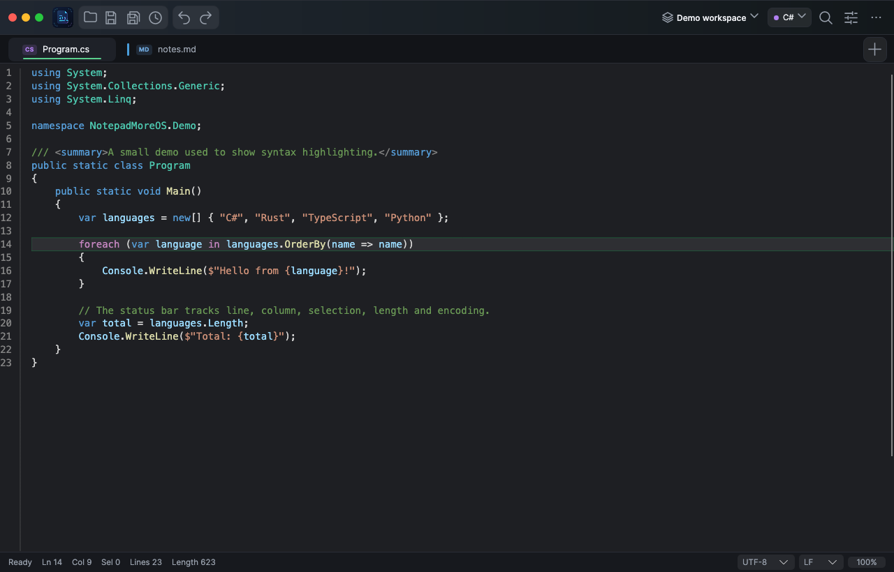
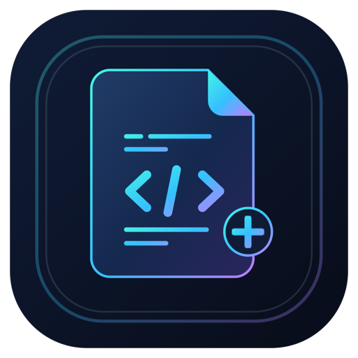
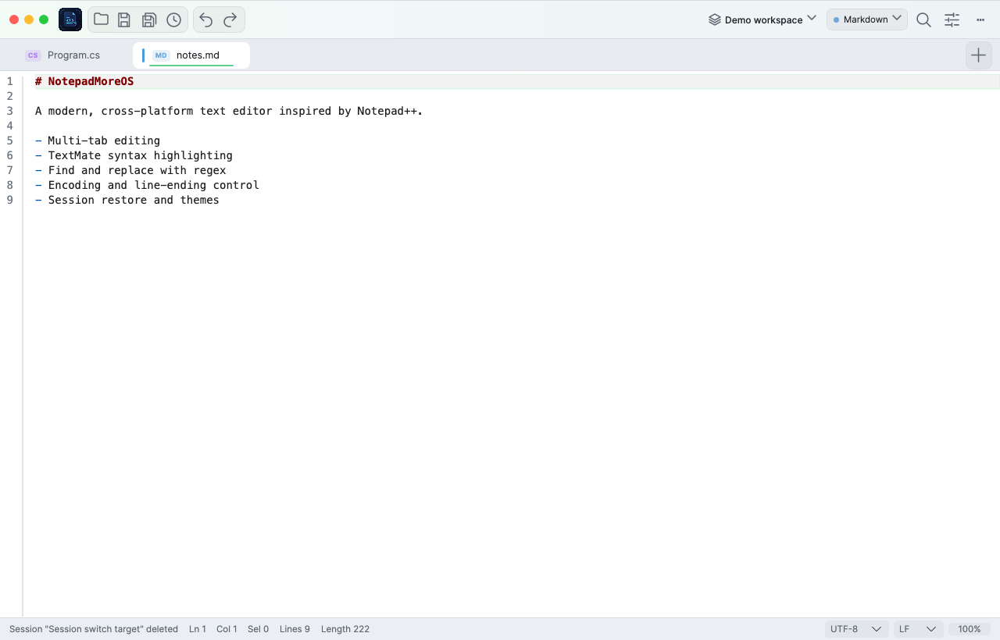
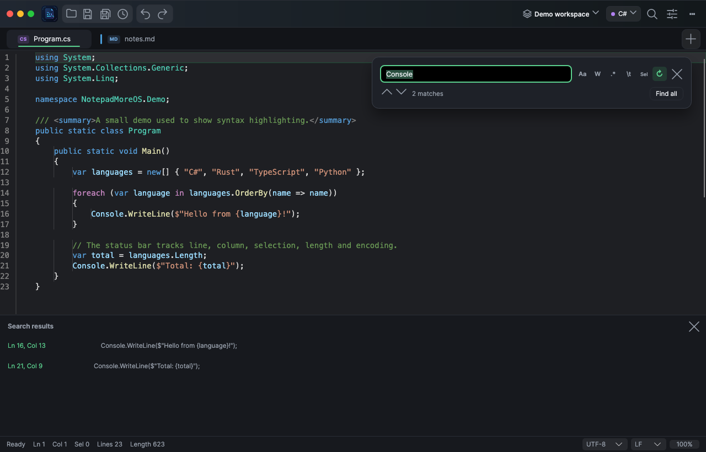
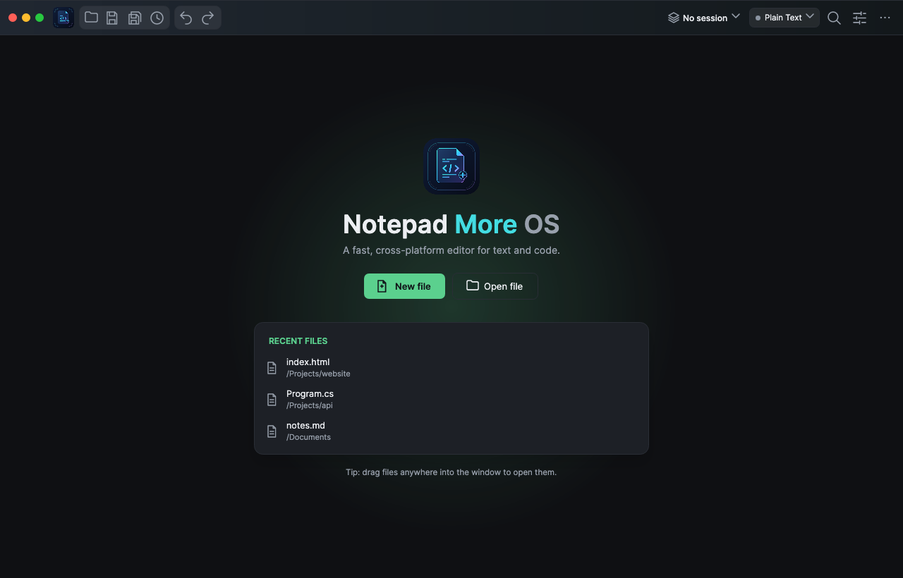
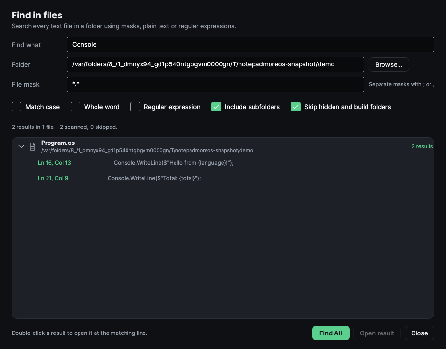
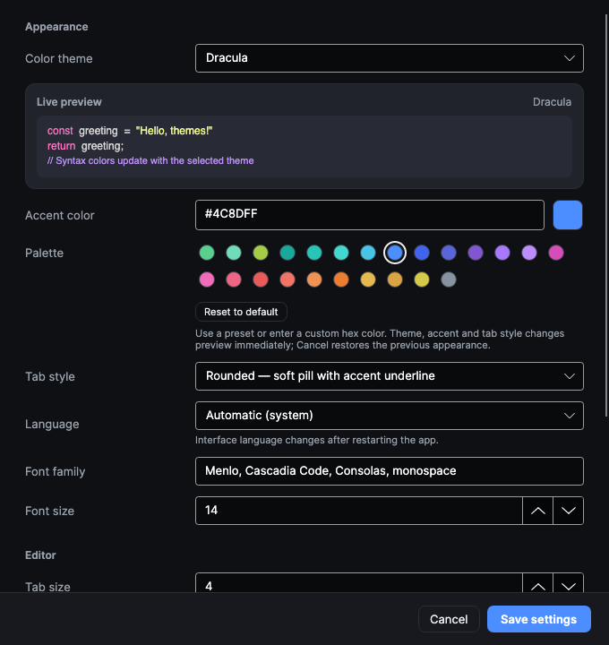

# NotepadMoreOS

O editor destaca pares correspondentes de `()`, `[]` e `{}` junto ao cursor; a opção pode ser desativada nas preferências. A correspondência considera os caracteres do texto, inclusive em comentários e strings.

[](https://github.com/Agarni/NotepadMoreOS/actions/workflows/build.yml)

Um editor de texto e código multiplataforma inspirado no **Notepad++**, construído com **Avalonia 12**, **.NET 10** e **AvaloniaEdit**. Versão atual: **1.7.5**.

O editor oferece quebra visual de linha e marcas de caracteres invisíveis por aba, prévia Markdown e formatação local de JSON, JSONC e XML. Consulte o [guia do usuário](docs/GUIA-USUARIO.md).

## Download

Os instaladores ficam em [Releases](https://github.com/Agarni/NotepadMoreOS/releases):

- **macOS (Apple Silicon):** prefira o `.zip` — extraia e arraste para Aplicativos; na primeira abertura use **Ajustes do Sistema → Privacidade e Segurança → Abrir Mesmo Assim**. Se preferir o `.dmg` e ele nem montar, rode `xattr -d com.apple.quarantine ~/Downloads/NotepadMoreOS-*.dmg`.
- **Windows x64:** `setup.exe` — assistente com atalhos e associações opcionais; o SmartScreen pede confirmação por não haver assinatura.
- **Linux:** `.deb` (Debian/Ubuntu) com `sudo apt install ./NotepadMoreOS-*-linux-amd64.deb`, ou o `.tar.gz` portátil.

Nenhum pacote exige o .NET instalado.



## Identidade visual

A identidade da aplicação parte da referência visual de um documento com canto dobrado, código e sinal de “mais”. A proposta 3 foi escolhida: uma folha azul-escura com contorno luminoso ciano/azul/violeta sobre fundo navy, mantendo o símbolo legível como ícone pequeno. O wordmark **NotepadMoreOS** é tratado separadamente, com “More” em ciano.



| Tema claro | Busca com resultados |
|---|---|
|  |  |

Tela de boas-vindas com arquivos recentes:



| Busca em arquivos | Preferências |
|---|---|
|  |  |

## Documentação

- [Índice da documentação](docs/README.md)
- [Visão geral](docs/VISAO-GERAL.md) — o que é e como está organizado, para qualquer público.
- [Guia do usuário](docs/GUIA-USUARIO.md) — para qualquer pessoa que queira usar o editor.
- [Arquitetura](docs/ARQUITETURA.md) — como o editor funciona por dentro.
- [Guia de desenvolvimento](docs/DESENVOLVIMENTO.md) — convenções, receitas e armadilhas.
- [Roadmap](docs/ROADMAP.md) — prioridades e limitações planejadas.
- [Release](docs/RELEASE.md) — como gerar e publicar os instaladores.
- [AGENTS.md](AGENTS.md) — contexto operacional para agentes de IA.
- [Changelog](CHANGELOG.md) — o que mudou em cada versão.

## Por que existe

O Notepad++ é excelente, mas é exclusivo para Windows. O NotepadMoreOS leva a mesma proposta — abrir rápido, editar qualquer texto, destacar sintaxe e manter várias abas — para macOS, Windows e Linux com uma interface moderna.

## Recursos

### Edição
- Abas ilimitadas com indicador de alterações, fechar e nova aba
- Realce de sintaxe para 60+ linguagens via gramáticas TextMate
- Números de linha, linha atual destacada, espaços e fim de linha visíveis
- Quebra de linha, zoom por documento e fonte configurável
- Autoindentação (inteligente para C#)
- Duplicar/apagar linha, comentar/descomentar, inserir data e hora
- Seleção retangular, arrastar e soltar arquivos, desfazer/refazer por documento
- Detecção automática de linguagem pela extensão, com troca manual

### Arquivos
- Abrir vários arquivos, recentes e restaurar a sessão anterior
- Sessões nomeadas: criar sessões vazias, salvar, abrir, renomear e excluir conjuntos de arquivos, incluindo abas ainda não salvas com salvamento no rascunho da sessão
- Troca de sessão sem prompts, preservando automaticamente edições pendentes
- Salvar, Salvar como e Salvar tudo
- Codificações: UTF-8, UTF-8 com BOM, UTF-16 LE/BE, Windows-1252 e ISO-8859-1
- Detecção automática de codificação (inclui UTF-16 sem BOM) e de fim de linha
- Conversão de fim de linha: CRLF, LF ou CR
- Recarregar do disco, reabrir com codificação específica e abrir pasta do arquivo
- Salvamento atômico (arquivo temporário + troca), evitando arquivos truncados
- Detecção de alteração externa: recarrega arquivos limpos e pede confirmação quando há edições locais
- Rascunhos não salvos preservados entre sessões (sem sobrescrever o original e sem prompt por padrão), com recuperação após fechamento inesperado

### Busca
- Localizar e substituir com expressões regulares
- Pesquisa estendida com escapes como `\t`, `\r`, `\n`, `\\`, `\0`, `\xNN`, `\uNNNN` e `\oNNN`
- Contagem de ocorrências ao vivo enquanto você digita, com posição atual ao navegar
- Diferenciar maiúsculas/minúsculas, palavra inteira, buscar na seleção
- Localizar próximo/anterior com retorno circular, contador de ocorrências
- Localizar tudo com painel de resultados navegável
- Localizar em arquivos de uma pasta, com máscaras, regex, subpastas, cancelamento e progresso
- Abrir um resultado da busca diretamente na linha correspondente
- Ir para linha

### Interface
- Interface em inglês ou português do Brasil, seguindo o idioma do sistema ou a escolha em Preferências
- Temas claro e escuro com 21 temas TextMate
- Pré-visualização imediata de temas e cor de destaque configurável (paleta de 24 cores ou código hex)
- Três estilos de aba — arredondada, flutuante (tipo Safari) e conectada — com prévia nas preferências
- Cor de destaque também pelo menu **View → Accent Color**, com indicação da cor ativa e opção de voltar ao padrão
- Paleta e estilos próprios sobre o FluentTheme
- Barra de status com linha/coluna, seleção, tamanho, codificação, EOL, linguagem e zoom
- Menu nativo do macOS e atalhos nativos (Cmd no macOS, Ctrl nos outros sistemas)
- Barra de workspace com identidade, ações rápidas, chip de sessão e seletor de linguagem
- Menu de contexto nas abas: fechar múltiplas, fixar, salvar, renomear, recarregar, lixeira, somente leitura, copiar, mover e cor da aba
- No macOS, a barra de workspace é a própria title bar: sem barra do SO, com traffic lights integrados
- Visual moderno: tabs, chips de status, cores por linguagem e cor de destaque consistente
- Tela de boas-vindas com arquivos recentes
- Preferências persistentes em JSON

## Stack

| Camada | Tecnologia |
|---|---|
| UI | Avalonia 12.1 |
| Runtime | .NET 10 |
| Editor | Avalonia.AvaloniaEdit 12 + AvaloniaEdit.TextMate |
| Realce | TextMateSharp.Grammars |
| MVVM | CommunityToolkit.Mvvm |
| DI | Microsoft.Extensions.DependencyInjection |
| Testes | xUnit |

## Como executar

Requisitos: [.NET 10 SDK](https://dotnet.microsoft.com/download).

```bash
dotnet restore
dotnet run --project src/NotepadMoreOS
```

Ou abra `NotepadMoreOS.sln` na sua IDE.

## Testes

```bash
dotnet test
```

A suíte cobre detecção/conversão de codificação, reabertura forçada, fim de linha, busca/substituição (texto e regex), busca em arquivos, watcher de alterações externas, recuperação após crash, sessões nomeadas, ações de aba, lixeira, estado sujo/undo, navegação para resultados e persistência de preferências.

Para verificar a interface sem abrir uma janela:

```bash
dotnet run --project tools/NotepadMoreOS.UiSnapshot
```

A ferramenta renderiza a tela principal e os diálogos com Avalonia Headless + Skia, grava os PNGs em `docs/` e imprime avisos de binding.

## Publicar

```bash
# macOS (Apple Silicon)
dotnet publish src/NotepadMoreOS -c Release -r osx-arm64 --self-contained true -p:PublishSingleFile=true

# macOS (Intel)
dotnet publish src/NotepadMoreOS -c Release -r osx-x64 --self-contained true -p:PublishSingleFile=true

# Windows
dotnet publish src/NotepadMoreOS -c Release -r win-x64 --self-contained true -p:PublishSingleFile=true

# Linux
dotnet publish src/NotepadMoreOS -c Release -r linux-x64 --self-contained true -p:PublishSingleFile=true
```

## Atalhos

`Cmd` no macOS; nos demais sistemas use `Ctrl`.

| Ação | Atalho |
|---|---|
| Novo arquivo | `Cmd+N` |
| Abrir | `Cmd+O` |
| Salvar / Salvar como / Salvar tudo | `Cmd+S` / `Cmd+Shift+S` / `Cmd+Alt+S` |
| Fechar aba / fechar todas | `Cmd+W` / `Cmd+Shift+W` |
| Localizar | `Cmd+F` |
| Substituir | `Cmd+Alt+F` |
| Localizar próximo / anterior | `F3` / `Shift+F3` |
| Buscar em arquivos | `Cmd+Shift+F` |
| Ir para linha | `Cmd+G` |
| Duplicar linha / apagar linha | `Cmd+D` / `Cmd+L` |
| Comentar / descomentar | `Cmd+Alt+C` |
| Inserir data e hora | `F5` |
| Próxima / aba anterior | `Ctrl+Tab` / `Ctrl+Shift+Tab` |
| Zoom + / − / 100% | `Cmd+=` / `Cmd+-` / `Cmd+0` |
| Quebra de linha | `Cmd+Alt+W` |
| Preferências | `Cmd+,` |
| Fechar barra de busca | `Esc` |

## Estrutura

```
src/NotepadMoreOS/
  Models/        configurações, codificações, fins de linha, busca
  Services/      arquivos, busca, configurações, linguagens, temas, diálogos
  ViewModels/    MainWindow, Document, FindReplace, FindInFiles, Settings (MVVM)
  Views/         MainWindow, DocumentView, WelcomeView e diálogos
  Styles/        paleta clara/escura, ícones e estilos
  Assets/        ícone do aplicativo
tests/
  NotepadMoreOS.Tests/
tools/
  NotepadMoreOS.UiSnapshot/   screenshots headless para QA e documentação
docs/                         documentação e imagens
```

O `TextDocument` de cada aba pertence ao ViewModel; a view apenas hospeda o `TextEditor` e conecta caret/seleção. Assim, busca, undo e estado sujo funcionam sem depender da árvore visual.

## Limitações e próximos passos

Ainda não implementado:

- Impressão
- Macros e sistema de plugins
- Lista de funções, mapa de documento e explorador de pastas
- Comparação de arquivos
- Filtros personalizados de exclusão na busca em arquivos
- Localização da interface
- Instaladores assinados para distribuição
- Edição de arquivos muito grandes (o conteúdo é carregado inteiro em memória)

Contribuições são bem-vindas. O projeto é independente e não tem vínculo com o Notepad++.

## Créditos

- [Avalonia](https://avaloniaui.net/) — framework de UI multiplataforma
- [AvaloniaEdit](https://github.com/AvaloniaUI/AvaloniaEdit) — editor de texto
- [TextMateSharp](https://github.com/danipen/TextMateSharp) — gramáticas e temas
- [Notepad++](https://github.com/notepad-plus-plus/notepad-plus-plus) — inspiração

## Licença

MIT. Veja [LICENSE](LICENSE).
