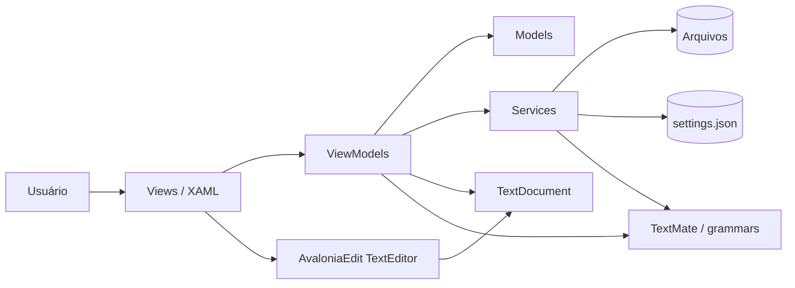
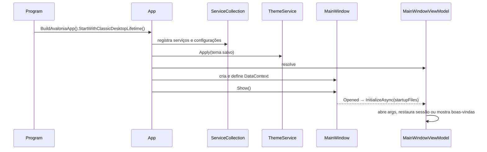
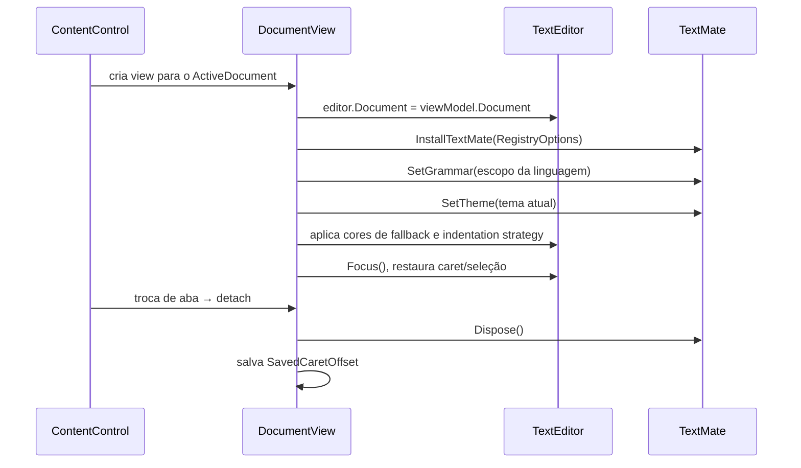
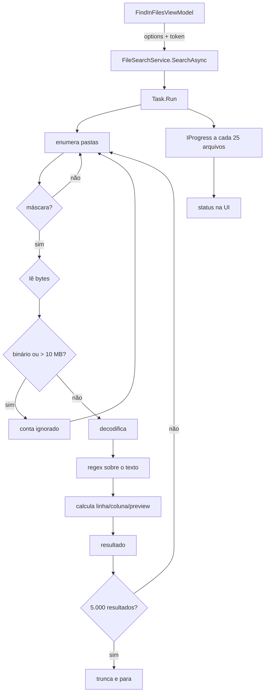
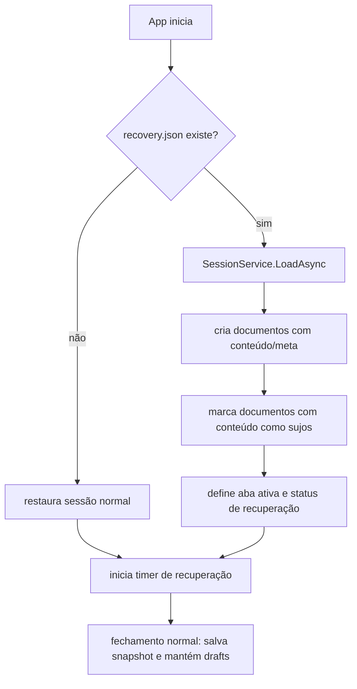

# Arquitetura — NotepadMoreOS

Este documento descreve como o NotepadMoreOS funciona por dentro. Ele foi escrito para quem vai manter, revisar ou estender o projeto. Para instruções de uso, consulte o [Guia do usuário](GUIA-USUARIO.md). Para receitas de mudança e convenções, consulte o [Guia de desenvolvimento](DESENVOLVIMENTO.md).

## 1. Resumo

O NotepadMoreOS é um aplicativo desktop multiplataforma em **Avalonia 12 / .NET 10**, organizado em MVVM com **CommunityToolkit.Mvvm**. O editor é o **AvaloniaEdit**, com realce de sintaxe via **TextMateSharp**.

As decisões centrais são:

- cada documento aberto tem um `TextDocument` de modelo, pertencente ao seu `DocumentViewModel`;
- a view do editor (`DocumentView`) hospeda o controle `TextEditor` e apenas conecta caret, seleção e ciclo de vida;
- serviços cuidam de arquivos, codificações, busca, temas, configurações e diálogos;
- a busca em arquivos roda fora da thread de UI, com cancelamento e limites explícitos;
- o estado sujo usa o marcador de arquivo original do `UndoStack`, não uma cópia do texto.

## 2. Stack e versões

| Componente | Versão | Papel |
|---|---|---|
| .NET | 10 | Runtime e SDK |
| Avalonia | 12.1.6 | UI, janelas, estilos, plataforma |
| Avalonia.AvaloniaEdit | 12.0.0 | Editor de texto |
| AvaloniaEdit.TextMate | 12.0.0 | Integração de gramáticas e temas TextMate |
| TextMateSharp.Grammars | 2.0.3 (transitiva) | Gramáticas embutidas |
| CommunityToolkit.Mvvm | 8.4.0 | Observáveis, comandos |
| Microsoft.Extensions.DependencyInjection | 10.0.0 | Composição de serviços |
| xUnit | 2.9.3 | Testes |

O projeto está fixado em `net10.0` e usa bindings compilados por padrão (`AvaloniaUseCompiledBindingsByDefault=true`).

## 3. Visão de contexto



As views não acessam arquivos diretamente para lógica de negócio. Os ViewModels orquestram serviços e expõem estado/comandos. A única ponte imperativa entre view e editor é a interface `IEditorHost`, implementada por `EditorHost` sobre o `TextEditor`.

## 4. Estrutura

```text
src/NotepadMoreOS/
  Program.cs                 bootstrap do Avalonia, encoding provider
  App.axaml(.cs)             recursos, estilos, DI, janela principal
  Models/
    AppSettings.cs           preferências e estado de sessão
    LineEnding.cs            enum, catálogo, detecção e normalização
    TextEncoding.cs          enum e catálogo de codificações
    LanguageInfo.cs          linguagem exibida na UI
    SearchModels.cs          opções e ocorrências de busca
    FileSearchModels.cs      opções, resultados e resumo da busca em arquivos
    RecoveryModels.cs        metadados do snapshot de recuperação
    NamedSession.cs          sessões nomeadas e estado por arquivo
  Services/
    AppPaths.cs              caminhos de configuração por SO
    SettingsService.cs       leitura/gravação JSON com caminho configurável
    FileService.cs           leitura/gravação, BOM, codificação, EOL, binário
    LanguageService.cs       extensão → gramática/escopo TextMate
    ThemeService.cs          temas TextMate + tema do aplicativo
    SearchService.cs         regex/texto, escopo, replace, preview
    FileSearchService.cs     busca recursiva em disco, máscaras, cancelamento
    SessionService.cs        snapshot de recuperação e conteúdo de emergência
    FileWatchService.cs      observação de arquivos alterados externamente
    IEditorHost.cs           contrato de edição usado pelos ViewModels
    EditorHost.cs            implementação sobre TextEditor
    DialogService.cs         pickers e janelas modais
  ViewModels/
    MainWindowViewModel.cs   workspace, comandos, sessão, status
    DocumentViewModel.cs     documento, dirty, encoding, EOL, caret
    EditorSettingsViewModel.cs  opções globais do editor
    FindReplaceViewModel.cs  busca/substituição no documento
    FindInFilesViewModel.cs  busca em disco, grupos e status
    SettingsViewModel.cs     cópia editável das preferências
    SessionItemViewModel.cs  item de sessão nomeada no flyout
    RecentFileViewModel.cs   item de recente
    SearchResultItem.cs      resultado da busca no documento
  Views/
    MainWindow.axaml(.cs)    shell, menus, abas, barra de status
    DocumentView.axaml(.cs)  hospedagem do TextEditor e TextMate
    MainWindow.NativeMenu.cs menu nativo do macOS
    WelcomeView.axaml(.cs)   tela inicial
    Dialogs/                 preferências, sobre, ir para linha, mensagens,
                             salvar alterações e busca em arquivos
  Styles/
    Palette.axaml            brushes claros/escuros
    Icons.axaml              geometrias de ícones
    AppStyles.axaml          estilos, templates e classes
tests/NotepadMoreOS.Tests/   testes xUnit
tools/NotepadMoreOS.UiSnapshot/  screenshots headless com Skia
docs/                        esta documentação
```

## 5. Composição e inicialização



Todos os serviços são singletons no container. `DocumentViewModel` é criado manualmente por `MainWindowViewModel` para cada documento; isso mantém o ciclo de vida do documento explícito.

Responsabilidades de inicialização:

1. `Program` registra `CodePagesEncodingProvider` (necessário para Windows-1252).
2. `App.Initialize` carrega XAML, estilos e dicionários de recursos.
3. `App.OnFrameworkInitializationCompleted` monta o container, carrega `settings.json`, aplica o tema e abre a janela.
4. `MainWindow.Opened` chama `MainWindowViewModel.InitializeAsync`, que primeiro tenta recuperar um snapshot de crash, depois abre arquivos de linha de comando, restaura a sessão normal ou deixa a tela de boas-vindas.
5. No macOS real, o menu nativo da aplicação é instalado em `App.Initialize`; o menu da janela é instalado uma única vez após o `Loaded`, quando a janela nativa já existe.

## 6. Documento

### 6.1 Modelo

`DocumentViewModel` é dono de um `TextDocument` do AvaloniaEdit. O controle visual **não usa binding de `Text`**: `DocumentView` atribui `editor.Document = viewModel.Document` no attach e escuta a propriedade `Document` para trocas (por exemplo, reload). Isso evita copiar o texto inteiro a cada tecla e mantém offsets, undo e busca alinhados.

```csharp
public TextDocument Document => _document;
public int Length => _document.TextLength;
public bool CanUndo => _document.UndoStack.CanUndo;
```

O documento é trocado em `LoadAsync`/`ReloadAsync`:

1. lê bytes;
2. detecta BOM/UTF-16/UTF-8/Windows-1252;
3. cria um novo `TextDocument` com o texto;
4. limpa e marca o `UndoStack` como original;
5. notifica a view para reatribuir o documento.

### 6.2 Estado sujo

O estado sujo é derivado, não armazenado como uma cópia do texto:

```text
dirty = !Document.UndoStack.IsOriginalFile || Encoding.Kind != _savedEncoding
```

- Alterações normais são vistas pelo `UndoStack`.
- Desfazer até o ponto salvo zera o indicador.
- Trocar a codificação de gravação marca como sujo mesmo sem editar caracteres.
- `MarkAsOriginalFile()` é chamado após carregar e após salvar.

### 6.3 Codificação e fim de linha

`FileService` é a fronteira de bytes:

- detecta BOM UTF-8, UTF-16 LE/BE;
- tenta UTF-16 sem BOM por heurística de bytes zero;
- valida UTF-8 estrito e cai para Windows-1252 quando inválido;
- detecta o fim de linha dominante;
- normaliza EOL antes de gravar;
- grava com arquivo temporário + `File.Move(..., overwrite: true)` para evitar truncamento;
- adiciona o preâmbulo/BOM correspondente ao codificar UTF-8 BOM/UTF-16;
- expõe `IsProbablyBinary` para a busca em arquivos.

Trocar o fim de linha no `DocumentViewModel` substitui o texto por uma versão normalizada, com grupo de undo — por isso a alteração é desfazível e marca o documento como sujo.

### 6.4 Navegação para uma ocorrência

A busca em arquivos pode abrir um arquivo que ainda não tem view anexada. Para isso o documento carrega um estado pendente:

- `SavedCaretOffset`
- `PendingSelectionLength`
- `PendingSelectionLine`

`DocumentView` aplica esse estado depois do layout, chamando `ApplyPendingSelection(host)`, que seleciona o trecho e rola até a linha. Se a view já estiver anexada, `MainWindowViewModel` aplica imediatamente.

## 7. Ciclo de vida da view do editor



A área de abas usa um `ItemsControl` para a faixa e um `ContentControl` com `DataTemplate` para `DocumentViewModel`; ao trocar de aba, a view anterior é descartada e uma nova é criada. Isso simplifica o desligamento do TextMate e evita compartilhar um `TextDocument` entre múltiplos `TextView` simultâneos.

Detalhes importantes:

- `NotepadTextEditor` estende `TextEditor`, inicializa um documento vazio e sobrescreve `StyleKeyOverride` para `typeof(TextEditor)`. Sem isso, um controle derivado não recebe o `ControlTheme` do AvaloniaEdit.
- O painel de busca nativo do AvaloniaEdit é desinstalado (`SearchPanel.Uninstall()`), pois o produto tem barra de busca própria.
- A gramática é reaplicada quando `LanguageScope` muda.
- A indentação usa `CSharpIndentationStrategy` para C# e `DefaultIndentationStrategy` para os demais casos.
- Cores de seleção, linha atual, números de linha e caret vêm do tema TextMate com fallback para a paleta do app.
- Ao desanexar, a instalação TextMate é descartada e o caret é salvo para restauração.

## 8. Busca

### 8.1 Busca no documento

`SearchService` transforma `SearchOptions` em um `Regex`:

- texto literal é escapado; regex é opcional;
- modo estendido (`UseExtendedEscapes`) expande `\t`, `\r`, `\n`, `\\`, `\0`, `\a`, `\b`, `\f`, `\v`, `\xNN`, `\uNNNN` e `\oNNN` com `UnescapeExtended` antes de escapar o literal; escapes desconhecidos são preservados;
- palavra inteira usa lookarounds `(?<![\p{L}\p{N}_])` e `(?![\p{L}\p{N}_])`;
- `RegexOptions.Multiline` permite `^`/`$` por linha;
- `CultureInvariant` evita variações culturais inesperadas;
- timeout de 2 segundos;
- escopo opcional por seleção;
- ocorrências de comprimento zero são ignoradas em `FindAll`;
- `ReplaceAll` faz uma única passada, respeita o escopo e interpreta `$1` apenas em modo regex; nos demais modos `PrepareReplacement` expande escapes (quando estendido) e trata `$` literalmente.

`FindReplaceViewModel` mantém o estado da barra, a ocorrência atual, o escopo capturado, o painel de resultados e os comandos. Regex e pesquisa estendida são mutuamente exclusivos: ativar um desativa o outro. O texto substituído usa o `TextDocument` diretamente, com grupo de undo.

### 8.2 Busca em arquivos

`FileSearchService` roda em `Task.Run` e nunca toca a UI diretamente:



Regras:

- máscara separada por `;`, `,` ou quebra de linha; `*.*` equivale a `*`;
- subpastas opcionais; symlinks não são seguidos;
- por padrão, pastas ocultas (`.git`, `.vscode`, etc.) e pastas de build/dependência (`node_modules`, `bin`, `obj`, `dist`, etc.) são ignoradas;
- arquivos maiores que 10 MB e binários são contados como ignorados;
- codificação é detectada por arquivo; UTF-16 é suportado;
- resultado final é ordenado por caminho e offset;
- progresso usa `IProgress<FileSearchProgress>`, capturado no contexto da UI;
- cancelamento é cooperativo, verificado por arquivo;
- erros de permissão são ignorados por pasta, sem abortar a busca;
- o limite de 5.000 resultados protege a UI e é propagado como `Truncated`.

O ViewModel agrupa resultados por arquivo em `FileSearchGroupViewModel`. A janela modal retorna um `FileSearchResult` quando o usuário dá dois cliques ou usa **Open result**.

## 9. Temas

`ThemeService` combina duas noções:

1. **Tema do aplicativo** — define `Application.RequestedThemeVariant` (`Light`/`Dark`), afetando o FluentTheme, menus, diálogos, barra de status e paleta.
2. **Tema TextMate** — define cores de sintaxe do editor e é aplicado por instalação em cada `DocumentView`.

`Palette.axaml` centraliza brushes por `ThemeDictionaries`; `AppStyles.axaml` usa `DynamicResource` para acompanhar a troca. `DocumentView` reaplica o tema TextMate e as cores de fallback quando `ThemeChanged` é emitido.

`ThemeInfo` inclui uma amostra de sintaxe para a pré-visualização em Settings. Ao selecionar tema ou cor de destaque, `SettingsViewModel.PreviewChanged` aplica a mudança sem persistir; cancelar restaura os valores de `AppSettings`. A cor é armazenada como `#RRGGBB`; `ThemeService.AccentPalette` é a fonte única das 24 opções nomeadas, consumida pela paleta de Settings e pelos menus **View → Accent Color** (interno e nativo do macOS). `ThemeService.ApplyAccentColor` recalcula brushes e variantes do accent nos dicionários Light/Dark, incluindo gradientes, seleção, glow e a cor de texto sobre o accent.

Os temas não alteram o conteúdo nem o estado sujo. A preferência é persistida em `AppSettings.Theme`.

## 10. Persistência

`SettingsService` lê/grava `AppSettings` em JSON, com caminho injetável (usado pelos testes). O caminho padrão vem de `AppPaths`:

| SO | Caminho |
|---|---|
| macOS | `~/Library/Application Support/NotepadMoreOS/settings.json` |
| Windows | `%APPDATA%\NotepadMoreOS\settings.json` |
| Linux | `$XDG_CONFIG_HOME/notepadmoreos/settings.json` ou `~/.config/notepadmoreos/settings.json` |

Características:

- gravação best-effort; falha de preferências nunca derruba o editor;
- gravação com arquivo temporário + troca;
- alterações de opções são agrupadas por um `DispatcherTimer` de ~700 ms;
- ao fechar, `RequestCloseApplicationAsync` salva a sessão e as preferências;
- a sessão guarda caminho e caret de documentos com arquivo em disco;
- recentes são limitados a 15 itens e filtrados por existência ao reconstruir a lista;
- documentos sem caminho não são restaurados (roadmap).

## 11. Atalhos e teclado

`controls:ModExtension` cria gestos com o modificador primário correto:

- macOS: `Meta` (Cmd);
- Windows/Linux: `Control` (Ctrl).

O mesmo markup é usado em `Window.KeyBindings` (execução) e em `MenuItem.HotKey` (exibição). Assim, o texto exibido acompanha a plataforma.

Alguns atalhos foram escolhidos para evitar conflitos do macOS:

- **Comentar** é `Cmd+Alt+C`, não `Cmd+Q` (reservado para sair).
- **Word wrap** é `Cmd+Alt+W`, não `Alt+Z` (Option+Z digita caracteres em alguns layouts).
- **Substituir** é `Cmd+Alt+F` (Cmd+H é o atalho de ocultar o app).
- **Aba anterior/próxima** usa `Ctrl+Tab` literal, pois `Cmd+Tab` é o alternador de aplicativos do sistema.

Edição de texto (copiar, colar, desfazer) fica com o `TextArea` do AvaloniaEdit; os comandos de menu delegam para `IEditorHost` para funcionar mesmo quando o foco não está no editor.

## 12. Concorrência e erros

- Abrir/salvar usa `File.ReadAllBytesAsync`/`WriteAllBytesAsync` com continuação na UI.
- A busca em disco usa uma thread de pool e reporta progresso via `IProgress`.
- A UI sempre atualiza estado (observáveis, status, diálogos) na thread de UI.
- Erros de IO em abrir/salvar viram diálogo de erro; o documento não é descartado silenciosamente.
- Arquivos/pastas inacessíveis durante a busca são ignorados e contabilizados.
- Regex com tempo excessivo (2 s) é abortada e tratada como sem resultados/skip.
- O fechamento é assíncrono: `Window.Closing` cancela o fechamento, pergunta sobre documentos sujos, salva sessão/preferências e só então fecha. `IsCloseApproved` evita prompts duplicados entre `Closing` e `ShutdownRequested`.
- `DialogService` centraliza pickers e janelas modais; a janela principal é anexada ao serviço depois de criada.

## 13. Testes e verificação

A suíte atual cobre:

- detecção e round-trip das codificações;
- normalização/detecção de EOL;
- busca literal, case, palavra inteira, regex, escopo, replace, preview, truncamento;
- busca em arquivos: máscaras, subpastas, binários, UTF-16, cancelamento, erros, limite;
- estado sujo e undo;
- carregamento, save, save as, reload e alteração de EOL/encoding;
- sessão, recentes, preferências, proxies da barra de status;
- navegação para resultado de busca (`ApplyPendingSelection`);
- ViewModel de busca em arquivos;
- recuperação (snapshot, restauração, limpeza no fechamento normal);
- reabertura forçada de codificação;
- watcher de arquivos e alterações externas;
- sessões nomeadas (salvar, abrir, renomear, excluir, pino/cor/read-only);
- ações do menu de contexto das abas (pino, cor, read-only, mover, fechar múltiplas);
- lixeira multiplataforma.

O `IEditorHost` permite testar lógica de busca sem uma janela real, usando um host falso sobre um `TextDocument`.

O `TextDocument` do AvaloniaEdit tem afinidade de thread. Testes assíncronos que criam ou acessam documentos após um `await` usam o helper `AsyncTest.Run`, que executa o corpo em uma thread dedicada com um `SynchronizationContext` bombeado. Sem isso, o xUnit pode retomar a continuação em outra thread e disparar `Call from invalid thread`.

Verificação visual:

```bash
dotnet run --project tools/NotepadMoreOS.UiSnapshot
```

A ferramenta usa Avalonia.Headless + Skia, renderiza a tela principal e diálogos e grava PNGs em `docs/`. Ela ativa `LogToTrace` e imprime avisos de binding. Screenshots versionados são um artefato de QA e documentação.

## 14. Limites e desempenho

- O conteúdo de cada documento é mantido inteiro em memória.
- A busca em arquivos é sequencial por arquivo, com limite de 10 MB e 5.000 resultados.
- A troca de aba recria a view e a instalação TextMate; o cache de gramáticas fica no `RegistryOptions`.
- TextMate e o `TextView` mantêm o custo de tokenização por documento ativo.
- A barra de busca do documento é regex sobre o texto inteiro; documentos muito grandes podem ter latência perceptível. A contagem ao vivo usa `SearchService.CountMatches` e roda a cada mudança de critério, portanto herda esse custo.
- A recuperação guarda conteúdo de documentos sujos de até 20 MB; acima disso, o documento é restaurado a partir do disco.
- Watchers de arquivo são best-effort; caminhos de rede ou limites do sistema podem atrasar/perder eventos.

## 15. Decisões e trade-offs

| Decisão | Motivo | Trade-off |
|---|---|---|
| `TextDocument` no ViewModel, não binding de `Text` | evita cópia por tecla, preserva offsets/undo | exige integração manual da view |
| `IEditorHost` | desacopla comandos/view models do controle visual | mais uma interface e adapter |
| Instalação TextMate por view | ciclo de vida simples e isolado | custo ao trocar de aba |
| Menu dentro da janela | consistência entre plataformas | sem menu nativo do macOS maduro |
| Salvar com arquivo temporário | evita arquivo truncado | não preserva todos os metadados estendidos |
| Sessão salva só no fechamento | simples e previsível | não recupera após crash |
| Busca em arquivos em `Task.Run` | UI responsiva | uma busca por vez, sem paralelismo agressivo |
| Limite de 5.000 resultados | evita congelar a UI | resultados além do limite exigem refinar a busca |
| `Cmd+Alt+...` em atalhos conflitantes | respeita reservas do macOS | atalhos diferem do Notepad++ em alguns casos |
| Recuperação automática a cada poucos segundos | protege trabalho não salvo e evita prompts no fechamento | IO periódico e até 20 MB por documento sujo; drafts ficam no disco de configuração |
| Sessões nomeadas guardam caminhos e rascunhos de abas não salvas | reabrir a sessão restaura exatamente o workspace | conteúdo fica em `session-drafts/`, não em `settings.json` |
| Ações de aba passam por um evento no DocumentViewModel | funciona para qualquer aba, sem depender da aba ativa | um switch central em MainWindowViewModel |
| Watcher por arquivo com debounce/supressão | evita recarregar a cada gravação própria | um handle por arquivo e eventos podem falhar em rede |
| Menu nativo apenas no macOS real | experiência nativa sem quebrar headless/outros SOs | duplicação entre menu XAML e builder nativo |
| Gestos de edição omitidos no menu nativo | Cmd+C/V/X/Z continua indo ao controle focado | menu não exibe atalhos de edição |

## 16. Onde estender

| Necessidade | Ponto de entrada |
|---|---|
| Novo comando de menu/atalho | `MainWindow.axaml`, ViewModel correspondente |
| Nova preferência | `AppSettings`, `EditorSettingsViewModel`, `SettingsViewModel`, `SettingsWindow` |
| Novo diálogo | `Views/Dialogs`, `DialogService` |
| Nova linguagem/comentário | `LanguageService` (automático) e `DocumentViewModel.CommentPrefix` |
| Nova regra de busca | `SearchService` ou `FileSearchService` |
| Novo serviço | `Services/`, registro em `App.axaml.cs` |
| Novo teste | `tests/NotepadMoreOS.Tests` |
| Nova captura de tela | `tools/NotepadMoreOS.UiSnapshot` |

O [Guia de desenvolvimento](DESENVOLVIMENTO.md) detalha cada receita.


## 17. Fluxos adicionados na versão 1.2

### 17.1 Recuperação após fechamento inesperado

`SessionService` grava um snapshot do workspace em `recovery/`:

- metadados de todas as abas (caminho, título, caret, codificação, EOL, linguagem);
- conteúdo dos documentos sujos e das abas não salvas;
- arquivo `recovery.json` escrito atomicamente;
- arquivos de conteúdo nomeados com o `Guid` do documento.

O `MainWindowViewModel` captura um snapshot:

- aproximadamente a cada 6 segundos;
- após 2 segundos de uma mudança para estado sujo;
- ao adicionar/remover abas.

O snapshot de conteúdo é ignorado acima de 20 MB; nesse caso o documento é restaurado do disco. Gravações de conteúdo usam hash SHA-256 para evitar reescrever arquivos idênticos.

Fluxo de restauração:



Regras:

- documento com conteúdo recuperado é restaurado sem `MarkAsOriginalFile`, portanto começa sujo;
- documento sem conteúdo é carregado do caminho;
- com `RecoveryEnabled` ligado, o fechamento normal **salva** o snapshot e **não** pergunta por arquivo; o original não é gravado e a próxima startup restaura os rascunhos;
- com `RecoveryEnabled` desligado, o fechamento pergunta Save/Don't Save/Cancel e limpa a recuperação (após salvar sessão/preferências);
- cancelar o fechamento mantém a recuperação;
- `_recoverySuppressed` impede que um tick atrasado recrie a recuperação durante o fechamento;
- se o snapshot não puder ser gravado, o fechamento cai no fluxo de perguntas para não perder dados.

### 17.2 Reabrir com codificação

`FileService.Decode(bytes, encoding)` força uma codificação, ignorando BOM quando ele corresponde à codificação escolhida. `DocumentViewModel.ReopenWithEncodingAsync`:

1. lê o arquivo do disco com a codificação escolhida;
2. substitui o `TextDocument`;
3. preserva o caret;
4. marca o documento como salvo e usa a codificação forçada para gravações.

O menu **Encoding** expõe:

- Reopen with Encoding → detectar automaticamente + catálogo;
- Save with Encoding → catálogo com radio da codificação atual;
- Reload from Disk.

Reabrir é uma operação destrutiva em memória: se o documento estiver sujo, o ViewModel pede confirmação antes.

### 17.3 Alterações externas

`FileWatchService` cria um `FileSystemWatcher` por arquivo rastreado:

- filtro pelo nome do arquivo;
- eventos `Changed`, `Created`, `Deleted` e `Renamed`;
- debounce configurável (600 ms por padrão);
- supressão de 2 s em torno de gravações do próprio editor;
- eventos entregues em thread de pool; o ViewModel faz `Dispatcher.UIThread.Post`.

O `MainWindowViewModel`:

- rastreia ao abrir/salvar e remove ao fechar;
- ao salvar, suprime o caminho de origem e destino (Save As troca o rastreamento);
- arquivo limpo: `ReloadAsync` automático;
- arquivo sujo: confirmação **Reload** ou **Keep**;
- **Keep** adiciona o documento a `_declinedExternalChanges` e não pergunta novamente até salvar/reabrir;
- arquivo excluído: mantém o buffer e informa na barra de status;
- `_externalChangeInProgress` evita diálogos concorrentes.

### 17.4 Menu nativo do macOS

- O menu da **aplicação** (About/Preferences) é instalado em `App.Initialize`, antes da janela, para substituir o menu padrão com "About Avalonia".
- O menu da **janela** é construído em `MainWindow.NativeMenu.cs` e instalado **uma única vez** via `NativeMenu.SetMenu`, após `Loaded`.
- Instalar um segundo `NativeMenu` na mesma janela lança `The menu being updated does not match`; por isso o menu é mantido em uma única instância.
- O menu interno (`AppMenu`) é escondido no macOS real.
- Em headless (ferramenta de screenshots/testes), `IsHeadlessPlatform()` detecta `Avalonia.Headless` e mantém o menu interno para que a UI continue documentável.
- Itens de edição (Undo/Cut/Copy/Paste/Select All) não recebem `Gesture` no menu nativo, para que Cmd+C/V/X/Z continue sendo roteado ao controle focado (inclusive caixas de texto em diálogos).
- Submenus dinâmicos (recentes, tema, codificação) são recriados em `NeedsUpdate`.
- No macOS real, as `Window.KeyBindings` do XAML são limpas para não executar o mesmo comando duas vezes (menu nativo + binding). Apenas `Esc` é recriado, pois não existe item nativo equivalente.
- Os `HotKey` dos itens do menu interno também são limpos no macOS real, já que o menu interno fica oculto.

### 17.5 Renovação visual

- Paleta escura mais profunda (`#0F1013`) e clara mais suave (`#F4F6F8`).
- Acento verde consistente (`SystemAccentColor`), afetando checkboxes, foco e seleção de texto.
- Barra de workspace com gradiente, marca do aplicativo, ações compactas, chip de sessão e seletor de linguagem.
- Abas em pílula, com sublinhado de acento interno na aba ativa e sem preenchimento em hover; passar o mouse apenas revela o botão de fechar. Com muitas abas, a faixa usa setas de navegação nas extremidades em vez de barra de rolagem (a roda do mouse também rola horizontalmente).
- Três estilos de aba selecionáveis (`AppSettings.TabStyle`): **Rounded** (pílula com indicador interno de acento, padrão), **Floating** (estilo Safari, sem sublinhado) e **Connected** (abas clássicas). O estilo é aplicado por classes no `Border` da faixa e pré-visualizado em Settings.
- Badges coloridos por linguagem (`LanguageAccentBrush`/`LanguageSoftBrush` no `DocumentViewModel`).
- Barra de status com chips para codificação, EOL, linguagem e zoom.
- Tela de boas-vindas com brilho radial, cartão elevado e lista de recentes.
- Barra de busca com sombra mais alta, foco em verde e controles compactos.

### 17.6 Chrome próprio no macOS

- `MainWindow.InitializeCustomChrome` ativa `ExtendClientAreaToDecorationsHint` e `WindowDecorations.BorderOnly` no macOS real, removendo a barra de título do sistema e preservando o redimensionamento nativo.
- Os três traffic lights são controles Avalonia (`Button.traffic-light`), com Close/Minimize/Maximize próprios; aparecem também no headless para documentação, mas o chrome nativo só é alterado no macOS real.
- A `WorkspaceBar` é a title bar: arrastar áreas vazias chama `BeginMoveDrag`; duplo clique alterna maximizado/normal. Cliques em botões são ignorados pelo handler.
- No headless macOS, o menu interno e a barra de título do SO não existem; o menu interno é ocultado para que o screenshot represente o layout real.
- Windows/Linux mantêm o chrome nativo e o menu interno; os traffic lights ficam ocultos.

### 17.7 Identidade visual e logo

- A referência de marca é um documento com canto dobrado, linhas que lembram código e um sinal de “mais”, que expressa edição de texto/código e o nome More.
- A proposta 3, aplicada para avaliação, usa fundo azul-marinho, folha azul-escura, contorno luminoso ciano/azul/violeta, código e sinal de “mais”; prioriza contraste e reconhecimento em tamanhos pequenos.
- O símbolo e o wordmark `NotepadMoreOS` são peças independentes: a aplicação pode usar somente o símbolo no ícone de janela e uma composição com nome em telas de apresentação/documentação.
- `Assets/appicon.svg` é a fonte vetorial do ícone; `appicon.png` e `appicon.ico` são derivados usados pelas janelas e pelo empacotamento.
- A marca é um elemento visual, não uma dependência da lógica do editor. `WelcomeView`, About e ícone de janela compartilham `Assets/appicon.png`; o wordmark destaca “More” em ciano. Ao atualizá-la, verificar esses pontos e as screenshots.


## 18. Sessões nomeadas e menu de contexto

### 18.1 Sessões nomeadas

`NamedSession` (em `Models/NamedSession.cs`) guarda:

- id estável (usado pela pasta de rascunhos);
- nome;
- lista de `NamedSessionFile` com caminho, título, caret, estado sujo, pino, cor da aba, read-only, codificação, fim de linha, linguagem e arquivo de rascunho;
- índice ativo;
- data de salvamento.

As sessões vivem em `AppSettings.Sessions` e o nome atual em `AppSettings.CurrentSessionName`. O chip de sessão na barra de workspace expõe:

- criar uma sessão vazia (pede nome e esvazia o workspace, preservando o workspace atual);
- salvar abas atuais (pede nome se necessário);
- salvar como nova;
- renomear/excluir a sessão atual;
- abrir uma sessão salva;
- gerenciar uma sessão específica pelo menu ⋯.

`CreateEmptySessionAsync` cria uma `NamedSession` com lista de arquivos vazia e ativa a nova sessão. Antes de fechar as abas atuais, `CloseWorkspaceForSessionSwitchAsync` grava o workspace na sessão atual (ou cria uma sessão automática `Unsaved workspace` quando ainda não há nome), sem prompts. `SaveSessionWithNameAsync` coleta todas as abas. Abas sem caminho e abas com alterações pendentes têm o texto atual gravado em `session-drafts/<id>/<índice>.txt`; arquivos limpos continuam sendo reabertos do disco. Os arquivos originais nunca são modificados ao salvar a sessão. `OpenNamedSessionAsync`:

1. grava os rascunhos da sessão atual (ou de uma sessão automática) e fecha as abas sem prompts;
2. carrega o rascunho quando existe (`DocumentViewModel.RestoreSessionDraft`) ou o arquivo do disco;
3. aplica caret, estado sujo, pino, cor, read-only, codificação, EOL e linguagem;
4. define a sessão atual e a aba ativa.

Ao restaurar um rascunho sem caminho, `DocumentViewModel` guarda o caminho absoluto do rascunho em `SessionDraftPath`. A aba volta limpa (a sessão é a nova base) e `SaveDocumentAsync` grava no próprio rascunho, sem abrir **Save As**; **Save As...** continua exportando para um arquivo real e limpa `SessionDraftPath`. Arquivos de disco com edições pendentes restaurados por rascunho continuam sujos e `Save` grava no caminho original.

Salvar/renomear/excluir persiste imediatamente em `settings.json`. O gerenciamento por item usa `SessionItemViewModel` com comandos de abrir/renomear/excluir.

### 18.2 Menu de contexto das abas

O `ContextFlyout` da aba usa `DocumentViewModel.RequestActionCommand` com um parâmetro textual. O comando levanta `ActionRequested` com `DocumentActionEventArgs`; o `MainWindowViewModel` executa `HandleDocumentActionAsync` **no documento do evento**, não necessariamente na aba ativa.

Ações implementadas:

- fechar, fechar outras, fechar à esquerda/direita, fechar todas;
- fixar/desafixar (reordena o grupo fixado para o início; o X da aba some);
- salvar/salvar como;
- abrir pasta ou terminal no diretório;
- renomear arquivo no disco (atualiza watcher, recentes, sessões e sessão normal);
- mover para a lixeira (`FileService.MoveToTrashAsync`; macOS/Linux movem para a lixeira, Windows usa `SHFileOperation`);
- recarregar;
- alternar somente leitura;
- copiar caminho, nome ou conteúdo;
- mover aba para esquerda/direita/início/fim;
- aplicar/limpar cor da aba.

Pino, cor, read-only e caret são persistidos na recuperação e nas sessões nomeadas. A lixeira remove a aba do workspace após confirmação; alterações não salvas são descartadas nesse fluxo explícito.

## 19. Localização

- Textos de UI ficam em `Resources/Strings.resx` (inglês, padrão) e `Strings.pt-BR.resx`. `Strings.g.cs` expõe propriedades estáticas tipadas usadas no XAML (`{x:Static loc:Strings.Chave}`) e no código.
- `tools/localization/strings.tsv` é a fonte de autoria (`chave|inglês|português`); `tools/localization/generate.py` regenera os dois `.resx` e o acessor.
- `LocalizationService.Apply` define `CurrentUICulture` (não altera a cultura de formatação) antes do carregamento do XAML em `App.Initialize`.
- A preferência `AppSettings.Language` aceita `system`, `en` e `pt-BR`. Trocar o idioma exige reiniciar o aplicativo, pois os textos do XAML são resolvidos na carga.
- A ferramenta de snapshot fixa inglês para manter as capturas versionadas determinísticas; os testes fixam inglês em `TestCulture`.

### 18.3 Limitações

- Rascunhos de sessões nomeadas só são restaurados ao abrir a sessão; a recuperação automática continua sendo o mecanismo para fechamento inesperado.
- Impressão, atributo read-only do Windows e menu de plugins ainda não fazem parte do contexto.
- Não há janela dedicada de gerenciamento de sessões; o flyout cobre salvar/abrir/renomear/excluir e gerenciamento por item.
