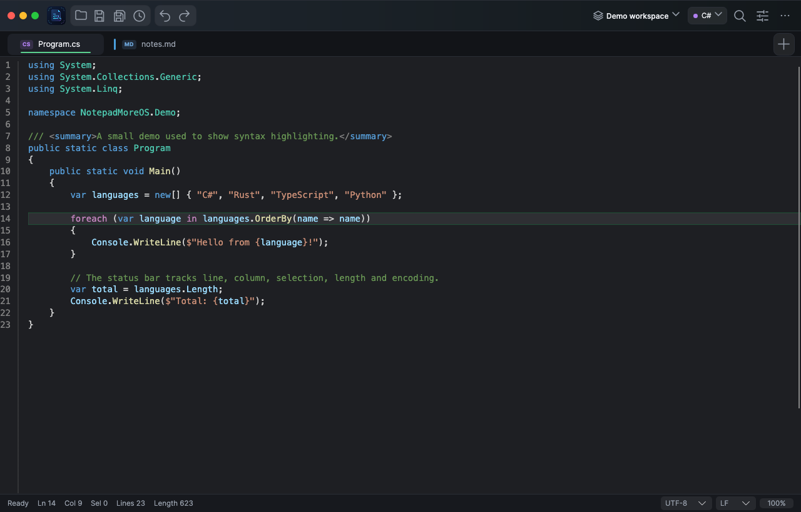
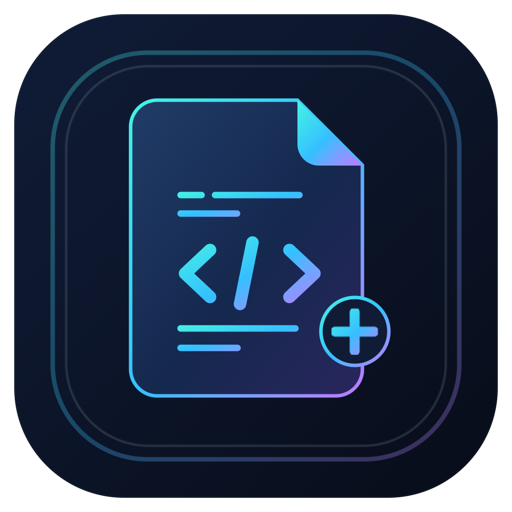
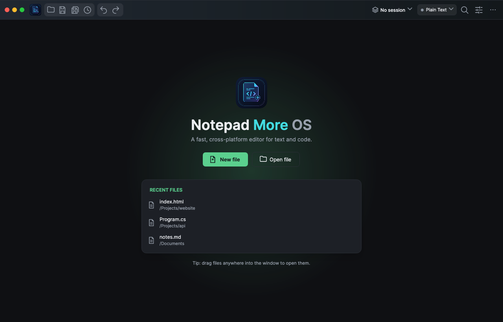
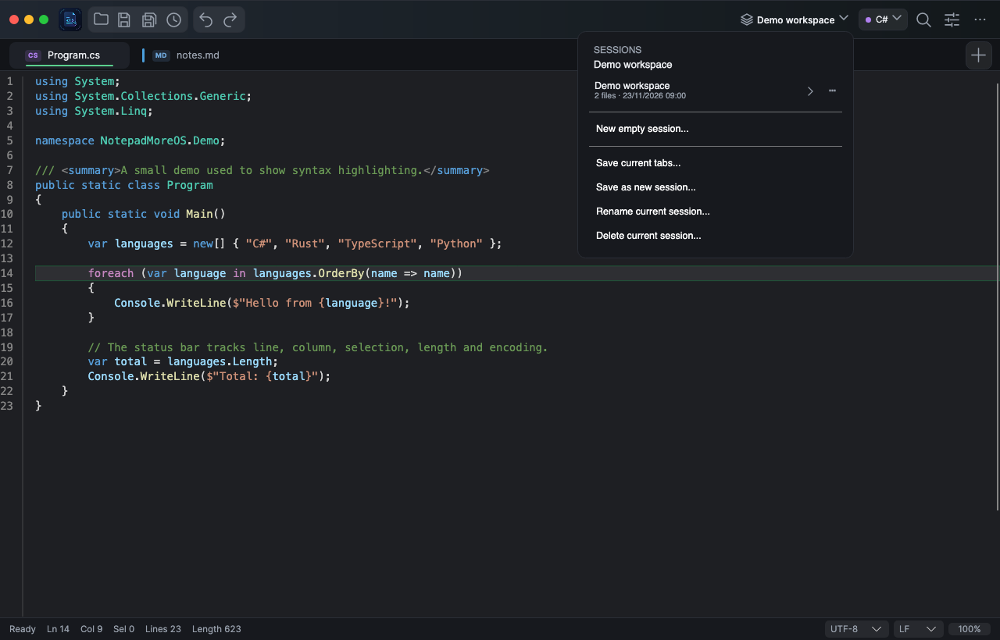
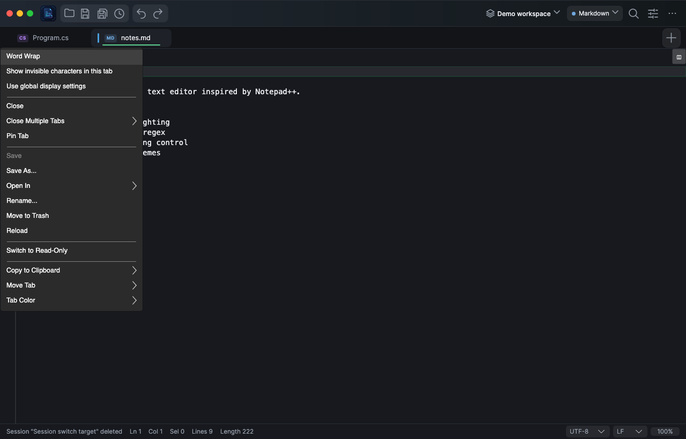
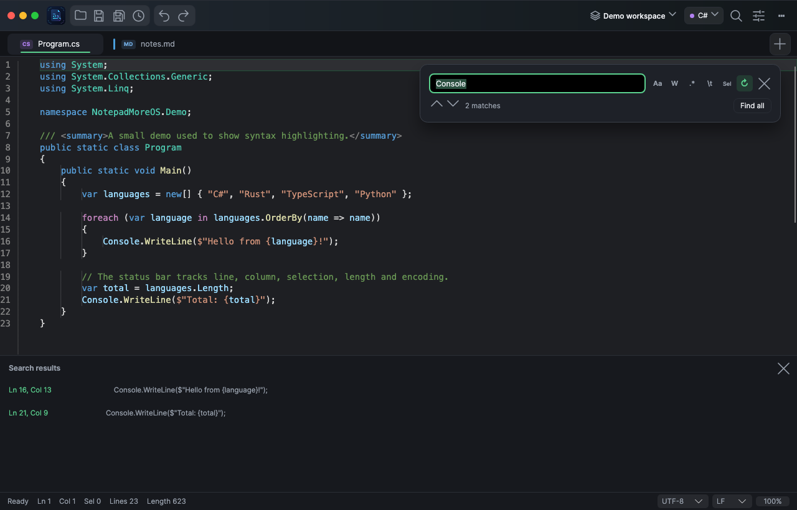
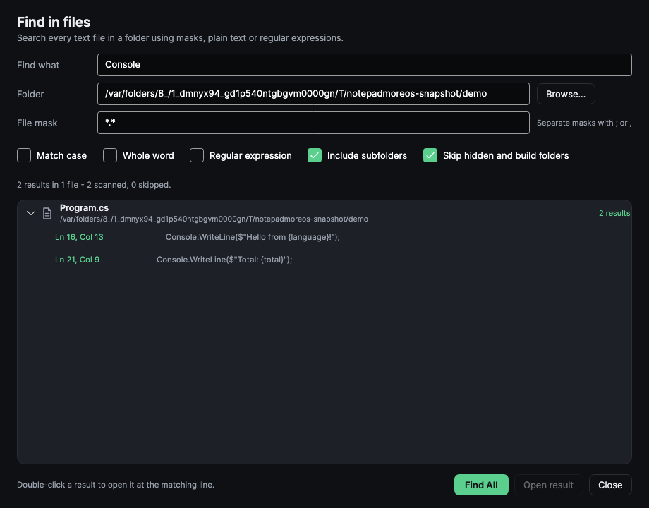

# Guia do usuário — NotepadMoreOS

O **NotepadMoreOS** é um editor de texto e código para macOS, Windows e Linux. Ele foi inspirado no Notepad++: abre rápido, edita qualquer arquivo de texto, destaca a sintaxe de várias linguagens e mantém vários arquivos abertos em abas.

Você não precisa saber programar para usar o editor. Este guia explica as tarefas do dia a dia em linguagem simples. Termos técnicos aparecem em um [glossário](#glossário) no final.



O símbolo do NotepadMoreOS combina uma folha de código azul-escura, detalhes luminosos em ciano/azul/violeta e um sinal de “mais”, que reforça a ideia de ferramentas adicionais para edição.



## 1. Como abrir o programa

### Se você recebeu uma versão publicada

**macOS:** o app não é notarizado pela Apple, então o macOS bloqueia tanto o **disco de instalação** quanto a primeira abertura do app.

1. Prefira o `.zip`: extraia, arraste **NotepadMoreOS** para a pasta **Applications**.
2. Tente abrir. O macOS bloqueia e mostra um aviso.
3. Abra **Ajustes do Sistema → Privacidade e Segurança**, role até **Segurança** e clique em **Abrir Mesmo Assim**. Confirme com Touch ID ou senha.

Se preferir o `.dmg` e o sistema recusar **abrir o próprio disco** (mensagem *“A Apple não pôde verificar se o item … está livre de malware”*), rode no Terminal e abra de novo:

```bash
xattr -d com.apple.quarantine ~/Downloads/NotepadMoreOS-*.dmg
```

Depois de arrastar o app para Aplicativos, a liberação também pode ser feita de uma vez:

```bash
xattr -dr com.apple.quarantine /Applications/NotepadMoreOS.app
```

O atalho **botão direito → Abrir** não existe mais desde o macOS 15. Os arquivos `LEIA-ME.txt` dentro do `.zip` e do `.dmg` repetem essas instruções.

**Windows:** execute o `NotepadMoreOS-<versão>-windows-x64-setup.exe` e siga o assistente. Você pode escolher criar atalho na área de trabalho, associar `.txt`, `.log` e `.md` e adicionar **Open with NotepadMoreOS** ao menu de contexto. O SmartScreen avisa por ser um binário sem assinatura: **Mais informações → Executar assim mesmo**.

**Linux:** no Debian/Ubuntu, instale com `sudo apt install ./NotepadMoreOS-<versão>-linux-amd64.deb` (ou `dpkg -i`). O app aparece no menu como **NotepadMoreOS** e também pode ser aberto pelo comando `notepadmoreos`. Para outras distribuições, use o `.tar.gz` portátil: extraia e execute `NotepadMoreOS/NotepadMoreOS`.

Nas três plataformas o pacote é self-contained: não é preciso instalar o .NET.

### Se você vai executar a partir do código

É necessário ter o [.NET 10 SDK](https://dotnet.microsoft.com/download) instalado.

```bash
cd NotepadMoreOS
dotnet run --project src/NotepadMoreOS
```

### Se você vai gerar seus próprios pacotes

```bash
# Instaladores (DMG no macOS, setup.exe no Windows, deb/tar.gz no Linux)
tools/release/build-installers.sh

# Só o bundle .app + .dmg
tools/release/build-macos.sh arm64

# Só o Windows (usa Docker + Inno Setup; gera zip se o Docker não estiver ativo)
tools/release/build-windows.sh

# Só o Linux (x64 ou arm64; gera .deb e .tar.gz)
tools/release/build-linux.sh x64
```

Os arquivos ficam em `artifacts/`. Para gerar um executável avulso:

```bash
dotnet publish src/NotepadMoreOS -c Release -r osx-arm64 --self-contained true -p:PublishSingleFile=true
dotnet publish src/NotepadMoreOS -c Release -r win-x64 --self-contained true -p:PublishSingleFile=true
dotnet publish src/NotepadMoreOS -c Release -r linux-x64 --self-contained true -p:PublishSingleFile=true
```

## 2. Primeiro contato

Ao abrir sem arquivos, o NotepadMoreOS mostra uma tela de boas-vindas com:

- **New file**: cria um documento vazio.
- **Open file**: abre um ou vários arquivos.
- **Recent files**: reabre arquivos usados recentemente.

Você também pode **arrastar arquivos para dentro da janela** para abri-los.



## 3. Conhecendo a janela

De cima para baixo:

1. **Menu**: Arquivo, Editar, Pesquisar, Codificação, Visualizar, Configurações e Ajuda. No macOS, os menus File/Edit/Search/Encoding/View/Help ficam na **barra superior do sistema**; o item com o nome do app contém About, Preferences e Quit.
2. **Barra de workspace/title bar**: no macOS não existe barra de título do sistema; esta barra é a própria janela, com os **traffic lights** (fechar, minimizar, maximizar), identidade do app, abrir/salvar/recentes, desfazer/refazer, chip de sessão, seletor de linguagem, buscar, configurações e o menu **⋯**.
3. **Abas**: cada arquivo aberto ocupa uma aba com badge colorido por linguagem. O ponto verde indica alterações ainda não salvas; a aba ativa recebe um destaque — sublinhado de acento, preenchimento ou borda, conforme o estilo escolhido. O botão **+** cria uma nova aba. Quando há muitas abas, setas nas extremidades rolam a faixa (a roda do mouse sobre as abas também rola).
4. **Editor**: área de edição, com números de linha e realce de sintaxe.
5. **Barra de status** (parte inferior):
   - mensagem da última ação;
   - linha e coluna do cursor;
   - tamanho da seleção;
   - número de linhas e caracteres;
   - codificação do arquivo (ex.: UTF-8);
   - tipo de fim de linha (CRLF, LF ou CR);
   - zoom.

   A linguagem do arquivo é escolhida somente no seletor da barra superior; a barra de status mostra apenas codificação, fim de linha e zoom.

## 4. Criar, abrir e salvar

### Criar

- `Cmd+N` no macOS ou `Ctrl+N` nos outros sistemas;
- ou **File → New**;
- ou o botão **+** na faixa de abas.

### Abrir

- `Cmd+O` / `Ctrl+O`;
- **File → Open**;
- arrastar o arquivo para a janela;
- **File → Open Recent**;
- clicar em um item da lista de recentes na tela de boas-vindas.

### Salvar

- **Salvar:** `Cmd+S` / `Ctrl+S`.
- **Salvar como:** `Cmd+Shift+S` / `Ctrl+Shift+S`.
- **Salvar tudo:** `Cmd+Alt+S` / `Ctrl+Alt+S`.

Ao fechar uma **aba** com alterações pendentes, o NotepadMoreOS pergunta se deseja salvar (**Save**), descartar (**Don't Save**) ou cancelar.

Ao fechar o **programa**, o comportamento padrão é **não perguntar** e preservar o trabalho:

- as abas e o conteúdo não salvo são mantidos em um snapshot de recuperação;
- o arquivo original **não é alterado**;
- na próxima abertura, as abas voltam com o conteúdo e o indicador de alteração, como estavam;
- para gravar a alteração no arquivo original, use **Save** (ou **Save As**).

Esse é o mesmo modelo de trabalho temporário do Notepad++: você pode sair sem decidir e continuar depois, sem tocar no arquivo original.

Se preferir o comportamento com perguntas, desmarque **Settings → Session → Keep unsaved changes between sessions (no prompt on exit)**. Nesse modo, o NotepadMoreOS pergunta **Save / Don't Save / Cancel** ao sair e descarta a recuperação depois.

Um asterisco no título da janela e um ponto verde na aba indicam alterações não salvas. Se você desfizer todas as alterações, o indicador desaparece.

### Recarregar e localizar o arquivo

- **File → Reload from Disk**: descarta o conteúdo atual e lê o arquivo novamente do disco.
- **File → Open Containing Folder**: abre a pasta do arquivo no gerenciador de arquivos.
- **File → Copy File Path**: copia o caminho completo do arquivo.

## 5. Editar texto

O editor funciona como um editor de texto comum:

- digitar, selecionar, copiar, recortar e colar;
- `Cmd+Z` / `Ctrl+Z` desfaz; `Cmd+Shift+Z` (ou `Ctrl+Y` no Windows/Linux) refaz;
- clique com o botão direito para abrir o menu de contexto.

Recursos úteis:

| Ação | Como fazer |
|---|---|
| Duplicar a linha atual | `Cmd+D` / `Ctrl+D` |
| Apagar a linha atual | `Cmd+L` / `Ctrl+L` |
| Comentar/descomentar | `Cmd+Alt+C` / `Ctrl+Alt+C` |
| Inserir data e hora | `F5` |
| Ir para uma linha | `Cmd+G` / `Ctrl+G` |
| Selecionar tudo | `Cmd+A` / `Ctrl+A` |
| Seleção retangular | `Alt` + arrastar no editor (quando suportado pelo layout) |

A indentação é automática: ao pressionar Enter, a linha seguinte copia a indentação anterior. Em arquivos C#, o editor também ajusta blocos entre chaves.

## 6. Abas e sessão

- Troque de aba clicando nela.
- `Ctrl+Tab` e `Ctrl+Shift+Tab` alternam entre abas.
- Feche uma aba pelo **X** que aparece ao passar o mouse sobre ela.
- No macOS, arraste áreas vazias da barra superior para mover a janela; duplo clique maximiza/restaura. Use os traffic lights para fechar, minimizar ou maximizar.
- `Cmd+W` / `Ctrl+W` fecha a aba atual.
- `Cmd+Shift+W` / `Ctrl+Shift+W` fecha todas as abas.

Com a recuperação ativada em **Settings → Preferences**, o NotepadMoreOS salva um snapshot ao fechar normalmente e restaura as abas e seus rascunhos na próxima abertura, sem gravar alterações nos arquivos originais. Se não for possível salvar o snapshot, o editor pergunta se você quer salvar as abas alteradas. Com a recuperação desativada, o fechamento pergunta o que fazer com alterações não salvas. A opção **Restore session** controla a restauração da sessão de arquivos e posições do cursor, separada da recuperação de rascunhos. Sessões nomeadas também guardam seus próprios rascunhos.

### Sessões nomeadas

O chip com ícone de camadas na barra superior mostra a sessão atual (ou **No session**). Clique nele para:

- **New empty session...** — cria uma sessão sem arquivos e fecha as abas atuais, preservando automaticamente edições pendentes.
- **Save current tabs...** — salva as abas atuais com um nome. Se a sessão ainda não tem nome, o editor pergunta.
- **Save as new session...** — cria outra sessão a partir das abas atuais.
- **Rename current session...** e **Delete current session...** — gerenciam a sessão atual.
- Selecionar uma sessão salva para abri-la.
- Usar o botão **⋯** ao lado de uma sessão para renomeá-la ou excluí-la.



Cada sessão guarda os caminhos dos arquivos, a posição do cursor, abas fixadas, cores, o estado somente leitura e o conteúdo de abas não salvas ou com edições pendentes. Esses rascunhos ficam em uma pasta própria de sessões e nunca alteram os arquivos originais.

Ao reabrir a sessão, as abas voltam como estavam. Abas que nunca foram salvas em disco começam sem o indicador de alteração; ao editá-las, o indicador volta e **Save** grava no rascunho da sessão sem pedir um nome. Use **Save As...** para exportar a aba para um arquivo real. Arquivos que já existem no disco e tinham edições pendentes continuam marcados como alterados, e **Save** grava no arquivo original. Cada sessão tem sua própria pasta de rascunhos, então salvar a mesma aba em outra sessão não altera a primeira. A recuperação automática continua cobrindo o fechamento inesperado do aplicativo.

Ao trocar de sessão, o NotepadMoreOS **não pergunta para salvar**. Ele grava automaticamente o workspace atual nos rascunhos da sessão atual e abre a próxima sessão. As edições e abas não salvas continuam disponíveis quando você voltar. Se o workspace atual ainda não tem sessão nomeada, uma sessão **Unsaved workspace** é criada automaticamente para guardar o conteúdo.

### Menu de contexto das abas

Clique com o botão direito em uma aba para acessar:



| Ação | Efeito |
|---|---|
| **Close** | Fecha a aba |
| **Close Multiple Tabs** | Fecha outras abas, à esquerda, à direita ou todas |
| **Pin Tab / Unpin Tab** | Fixa a aba no início e esconde o X; o menu ainda pode fechá-la |
| **Save / Save As...** | Salva a aba selecionada |
| **Open In** | Abre a pasta do arquivo ou um terminal nela |
| **Rename...** | Renomeia o arquivo no disco |
| **Move to Trash** | Move o arquivo para a lixeira do sistema |
| **Reload** | Recarrega o arquivo do disco |
| **Read-only / Read-write** | Alterna a edição somente leitura |
| **Copy to Clipboard** | Copia caminho, nome ou conteúdo |
| **Move Tab** | Move a aba para esquerda, direita, início ou fim |
| **Tab Color** | Aplica uma cor de destaque à aba |

O item **Print** não está disponível porque a impressão ainda não faz parte do editor.

## 7. Buscar e substituir no arquivo atual

Pressione `Cmd+F` / `Ctrl+F` para abrir a barra de busca no canto superior direito. A contagem de ocorrências aparece **enquanto você digita**, antes de navegar: por exemplo, `3 matches` ou `No matches`. Ao usar as setas, a mesma área passa a mostrar a posição atual, como `Match 2 of 3`.



### Botões da barra

| Controle | Significado |
|---|---|
| `Aa` | Diferenciar maiúsculas de minúsculas |
| `W` | Palavra inteira |
| `.*` | Usar expressão regular |
| `\t` | Pesquisa estendida: interpreta `\t`, `\r`, `\n`, `\\`, `\0`, `\xNN`, `\uNNNN` e `\oNNN` |
| `Sel` | Buscar apenas dentro da seleção |
| `↻` | Continuar do início/fim quando chegar ao final |
| Setas | Resultado anterior/próximo |
| **Find all** | Lista todas as ocorrências no painel de resultados |
| **X** | Fecha a barra |

Atalhos:

- `F3` próximo resultado;
- `Shift+F3` resultado anterior;
- `Esc` fecha a barra.

### Substituir

Pressione `Cmd+Alt+F` / `Ctrl+Alt+F` (ou **Search → Replace**) para mostrar também a linha de substituição:

1. digite o texto a localizar;
2. digite o texto substituto;
3. use **Replace** para substituir a ocorrência atual;
4. use **Replace All** para substituir todas.

### Expressões regulares

Com `.*` ativado, você pode usar expressões regulares:

- `id=(\d+)` encontra `id=123` e permite usar `$1` na substituição;
- `^TODO` encontra “TODO” no início de cada linha;
- `\bcat\b` encontra a palavra “cat” isolada.

Se a expressão estiver inválida, a barra mostra **Invalid regular expression**.

### Pesquisa estendida

Ative `\t` para interpretar sequências de escape como caracteres reais, sem escrever uma expressão regular:

| Escape | Representa |
|---|---|
| `\t` | Tabulação |
| `\r` | Retorno de carro (CR) |
| `\n` | Fim de linha (LF) |
| `\\` | Uma barra invertida literal |
| `\0` | Caractere nulo |
| `\a`, `\b`, `\f`, `\v` | Controle: sino, backspace, form feed, tabulação vertical |
| `\xNN` | Caractere pelo código hexadecimal (1 ou 2 dígitos) |
| `\uNNNN` | Caractere Unicode por 4 dígitos hexadecimais |
| `\oNNN` | Caractere pelo código octal (até 3 dígitos) |

Fora dos escapes, o texto é tratado literalmente: `a.b` encontra apenas `a.b`, não `axb`. Escapes desconhecidos, como `\q`, são mantidos como estão (barra invertida incluída). Em **Replace with**, as mesmas sequências também são interpretadas, então `\t` insere uma tabulação.

`\t` e `.*` são modos alternativos: ativar um desativa o outro. Com os dois desativados, a busca é literal.

### Painel de resultados

Ao usar **Find all**, o painel inferior lista cada ocorrência com linha, coluna e trecho. Clique em um resultado para saltar até ele.

## 8. Buscar em vários arquivos

Use `Cmd+Shift+F` / `Ctrl+Shift+F` ou **Search → Find in Files**.



1. Digite o texto ou a expressão regular.
2. Escolha a pasta com **Browse**.
3. Informe a máscara de arquivos, por exemplo:
   - `*.cs` — apenas C#;
   - `*.cs;*.md` — C# e Markdown;
   - `*.*` — todos os arquivos de texto.
4. Escolha as opções:
   - **Match case** / **Whole word** / **Regular expression**;
   - **Include subfolders** — inclui subpastas;
   - **Skip hidden and build folders** — ignora pastas como `.git`, `node_modules`, `bin`, `obj`, `dist`, etc.
5. Clique em **Find All**.
6. Dê dois cliques em um resultado para abrir o arquivo na linha correspondente.

Observações:

- São pesquisados arquivos de até **10 MB**.
- Arquivos binários são ignorados.
- A busca para após **5.000 resultados** para não travar a interface.
- A busca roda em segundo plano; o botão **Cancel** interrompe.
- A pasta inicial é a do arquivo ativo. Se não houver arquivo ativo, é usada a pasta pessoal.
- O texto selecionado no editor, se tiver apenas uma linha, já aparece como termo de busca.

## 9. Codificação e fim de linha

A barra de status mostra como o arquivo será salvo.

### Codificação

Há dois conceitos diferentes, ambos acessíveis pelo menu **Encoding**:

**Reopen with Encoding** reinterpreta o arquivo que está no disco usando a codificação escolhida. Ele descarta o texto atual em memória; se houver alterações não salvas, o editor pede confirmação. Use quando a detecção automática errar e os acentos/caracteres aparecerem errados.

- **Detect automatically** — tenta novamente a detecção automática;
- **UTF-8** / **UTF-8 with BOM**;
- **UTF-16 LE/BE**;
- **ANSI (Windows-1252)**;
- **ISO-8859-1**.

**Save with Encoding** define como o conteúdo atual será gravado. O seletor da barra de status também controla essa opção:

- **UTF-8** — recomendado para quase tudo;
- **UTF-8 with BOM** — útil para ferramentas antigas do Windows;
- **UTF-16 LE/BE** — comum em arquivos do Windows e ferramentas específicas;
- **ANSI (Windows-1252)** — arquivos legados do Windows;
- **ISO-8859-1** — arquivos latinos legados.

Exemplo: um arquivo ANSI legado abriu com caracteres estranhos porque foi detectado como UTF-8. Use **Encoding → Reopen with Encoding → ANSI**. O texto correto aparece e a codificação de gravação fica ANSI. Salve para preservar o formato original.

Ao abrir, o NotepadMoreOS tenta detectar a codificação automaticamente, incluindo UTF-16 sem BOM. Arquivos com BOM têm a marca removida da área de edição e preservada ao salvar na mesma codificação.

### Fim de linha

Clique em **CRLF**, **LF** ou **CR** para converter os finais de linha:

- **CRLF** — padrão do Windows;
- **LF** — padrão de macOS/Linux;
- **CR** — padrão antigo do Mac clássico.

A conversão altera o documento e marca como não salvo. Salve em seguida.

### Alterações feitas por outro programa

O editor observa os arquivos abertos:

- Se o arquivo foi alterado no disco e **não há edições locais**, ele é recarregado automaticamente e a barra de status informa a alteração.
- Se há **edições não salvas**, o editor pergunta antes de recarregar. Escolher **Keep** mantém o texto local e não pergunta novamente até você salvar ou recarregar manualmente.
- Se o arquivo for **excluído** no disco, a aba continua aberta com o conteúdo em memória e a barra de status avisa. Salvar recria o arquivo.
- Gravações feitas pelo próprio NotepadMoreOS são ignoradas pelo observador para não recarregar o documento sem necessidade.

## 10. Linguagem e realce de sintaxe

A linguagem é detectada pela extensão do arquivo. Você pode trocá-la no seletor da barra de status ou no seletor de linguagem da barra de workspace; isso altera o realce, o comportamento de comentários e a cor do badge da aba/painel.

Linguagens disponíveis incluem C, C++, C#, Java, JavaScript, TypeScript, Python, Ruby, Rust, Go, PHP, HTML, CSS, JSON, XML, Markdown, SQL, YAML, Shell, entre outras.

## 11. Aparência e conforto

Em **View**:

- **Word Wrap** — quebra linhas longas na largura da janela;
- **Line Numbers**;
- **Whitespace and Tabs** — mostra espaços e tabulações;
- **End of Line** — mostra marcações de fim de linha;
- **Highlight Current Line**;
- **Column Ruler** — guias nas colunas 80, 100 e 120;
- **Theme** — escolha entre temas claros e escuros;
- **Theme preview** — a prévia muda ao selecionar um tema; **Cancel** restaura o visual anterior e **Save settings** confirma a escolha;
- **Zoom In / Zoom Out / Reset Zoom**.

Em **Settings → Preferences**:

- tema;
- fonte e tamanho da fonte;
- tamanho da tabulação;
- usar espaços em vez de tabulações;
- quebra de linha e números de linha;
- exibição de espaços e fins de linha;
- linha atual e régua de colunas;
- restauração de sessão;
- manter alterações não salvas entre sessões, sem perguntar ao sair e sem alterar o original.

As preferências são salvas automaticamente.

### Visualização por aba

Use o menu de contexto da aba para alternar a quebra visual de linha ou mostrar espaços, tabulações e marcas de fim de linha juntos. Os ícones ↵ e ¶ aparecem quando a opção da aba difere da preferência global. **Usar opções globais de visualização** restaura os padrões. Abas recém-abertas seguem as preferências e as alterações individuais duram enquanto a aba estiver aberta.

### Prévia e formatação

Nos arquivos Markdown, use o ícone acima do editor para abrir a prévia abaixo do texto. Arraste o divisor horizontal entre o editor e a prévia para ajustar a altura dos painéis. O botão × fecha a prévia e o editor volta a ocupar a área disponível. Ao abri-la novamente, os painéis voltam a dividir o espaço igualmente.

Em JSON, JSONC e XML, use **Editar → Formatar JSON, JSONC ou XML**. O JSONC mantém comentários e aceita vírgulas finais. O XML preserva os espaços existentes, inclusive entre elementos, que podem ter significado no conteúdo. Por isso, a indentação automática é desativada quando esses espaços estão presentes. Se o conteúdo estiver inválido, o editor informa o erro e preserva o texto. Uma formatação aplicada pode ser desfeita.

### Idioma da interface

A interface está disponível em **inglês** e **português do Brasil**. Por padrão ela segue o idioma do sistema; para forçar outro, use **Settings → Appearance → Language**. A mudança é aplicada ao reiniciar o aplicativo.

Em **Settings → Appearance**, escolha uma das 24 cores da paleta ou digite um código hexadecimal de seis dígitos (por exemplo, `#4C8DFF`). Passe o mouse sobre uma cor para ver seu nome e código. A cor ativa aparece com um anel de destaque na paleta, e **Reset to default** volta ao verde original. A cor é aplicada à interface enquanto você testa; selecione **Save settings** para mantê-la ou **Cancel** para restaurar a anterior.

### Estilo das abas

Ainda em **Settings → Appearance**, o campo **Tab style** define como as abas são desenhadas:

| Estilo | Aparência |
|---|---|
| **Rounded** (padrão) | Pílulas suaves com sublinhado de acento na aba ativa |
| **Floating** | Abas mais espaçadas, no estilo Safari; a aba ativa se destaca pelo preenchimento, sem sublinhado |
| **Connected** | Abas clássicas com base reta encostada no editor e borda de acento na aba ativa |

A troca é mostrada na hora: confirme com **Save settings** ou use **Cancel** para voltar ao estilo anterior.

Para trocar mais rápido, use **View → Accent Color**: o menu lista as mesmas cores, marca a ativa e inclui **Reset to Default**. No macOS, o mesmo submenu aparece no menu nativo do sistema.

## 12. Atalhos

`Cmd` no macOS; `Ctrl` no Windows/Linux.

| Ação | Atalho |
|---|---|
| Novo arquivo | `Cmd+N` |
| Abrir | `Cmd+O` |
| Salvar / Salvar como / Salvar tudo | `Cmd+S` / `Cmd+Shift+S` / `Cmd+Alt+S` |
| Fechar aba / fechar todas | `Cmd+W` / `Cmd+Shift+W` |
| Localizar | `Cmd+F` |
| Substituir | `Cmd+Alt+F` |
| Próximo / anterior | `F3` / `Shift+F3` |
| Buscar em arquivos | `Cmd+Shift+F` |
| Ir para linha | `Cmd+G` |
| Duplicar / apagar linha | `Cmd+D` / `Cmd+L` |
| Comentar / descomentar | `Cmd+Alt+C` |
| Inserir data e hora | `F5` |
| Aba seguinte / anterior | `Ctrl+Tab` / `Ctrl+Shift+Tab` |
| Zoom + / − / 100% | `Cmd+=` / `Cmd+-` / `Cmd+0` |
| Quebra de linha | `Cmd+Alt+W` |
| Preferências | `Cmd+,` |
| Fechar a busca | `Esc` |

## 13. Onde ficam as preferências

- **macOS:** `~/Library/Application Support/NotepadMoreOS/settings.json`
- **Windows:** `%APPDATA%\NotepadMoreOS\settings.json`
- **Linux:** `~/.config/notepadmoreos/settings.json`

O arquivo guarda tema, fonte, recentes e estado da sessão. Ele pode ser apagado para voltar aos padrões.

Os snapshots de recuperação ficam em uma subpasta `recovery/` ao lado do `settings.json`. Apagar essa pasta descarta qualquer recuperação pendente.

## 14. Perguntas frequentes

**O programa não abre.**
Confira se o .NET 10 está instalado ao executar pelo código. Em uma versão publicada, confirme se o arquivo é compatível com o sistema (Intel/Apple Silicon, x64/ARM).

**O arquivo abriu com caracteres estranhos.**
A codificação foi detectada incorretamente. Use **Encoding → Reopen with Encoding** e escolha a codificação correta (por exemplo, ANSI ou ISO-8859-1). Depois salve com a codificação desejada.

**Fechei o app. Perdi meu texto?**
Por padrão, o NotepadMoreOS mantém rascunhos não salvos em um snapshot no fechamento normal. Ao reabrir, as abas e o conteúdo são restaurados sem alterar o arquivo original. Se o snapshot não puder ser salvo, o editor pergunta se você quer salvar as abas alteradas. Com a recuperação desativada, o fechamento também pergunta o que fazer com alterações não salvas.

**Outro programa alterou meu arquivo.**
Se não havia edições locais, o arquivo é recarregado. Se havia, o editor pergunta antes de descartar. Alterações feitas pelo próprio NotepadMoreOS não disparam o aviso.

**A busca em arquivos não encontra nada.**
Verifique a pasta, a máscara (`*.cs`, `*.txt`), as opções de maiúsculas/palavra inteira e se o arquivo não é binário, maior que 10 MB ou está em uma pasta ignorada.

**A busca em arquivos encontrou resultados desatualizados.**
A busca lê o conteúdo do disco. Se o arquivo estiver aberto com alterações não salvas, o resultado pode não corresponder ao texto na tela. Salve antes de buscar.

**Posso usar comercialmente?**
Sim. O projeto usa a licença MIT; consulte [LICENSE](../LICENSE).

**Onde reporto um problema?**
Abra uma issue no repositório do projeto com passos para reproduzir, sistema operacional e versão do NotepadMoreOS.

## 15. Limitações atuais

- Sem impressão.
- Sem macros ou plugins.
- Sem comparação de arquivos.
- Sem lista de funções, mapa de documento ou explorador de pastas.
- Sem filtros personalizados de exclusão na busca em arquivos.
- Sem instaladores assinados para distribuição.
- Arquivos grandes são carregados inteiros na memória.
- Interface em inglês e português do Brasil (a documentação permanece em português).

O [roadmap](ROADMAP.md) descreve as prioridades.

## Glossário

- **Aba:** área que representa um arquivo aberto.
- **Codificação (encoding):** regra que transforma texto em bytes. Ex.: UTF-8, UTF-16, ANSI.
- **Fim de linha (EOL):** caracteres que indicam o fim de uma linha: CRLF, LF ou CR.
- **Expressão regular (regex):** linguagem para descrever padrões de texto.
- **Sintaxe:** estrutura da linguagem; o realce colorido facilita a leitura.
- **Sessão:** conjunto de arquivos abertos e posições de cursor restaurados na inicialização.
- **BOM:** marca opcional no início de arquivos Unicode que identifica a codificação.
- **Binário:** arquivo que não é texto legível (imagens, executáveis, compactados).
