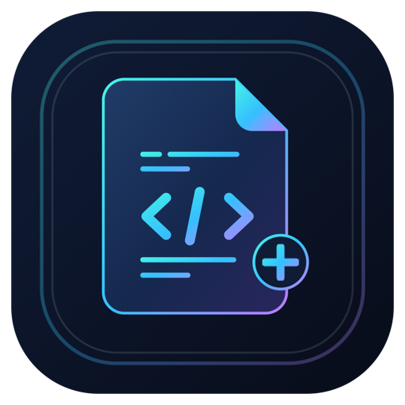
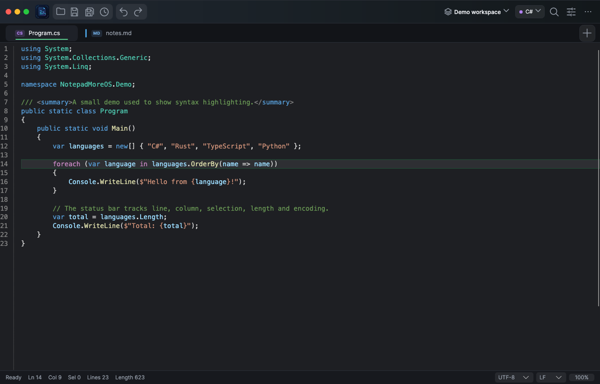
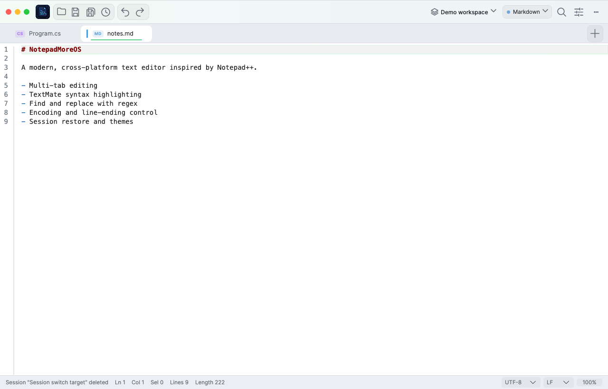
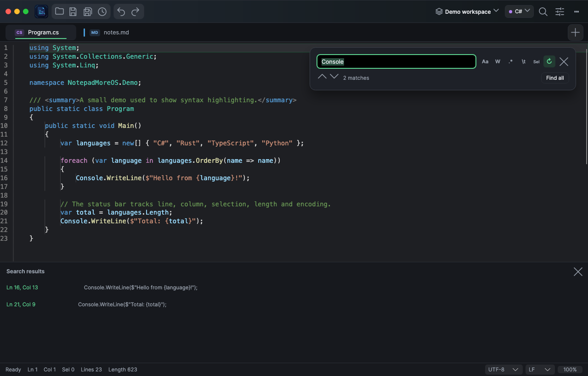
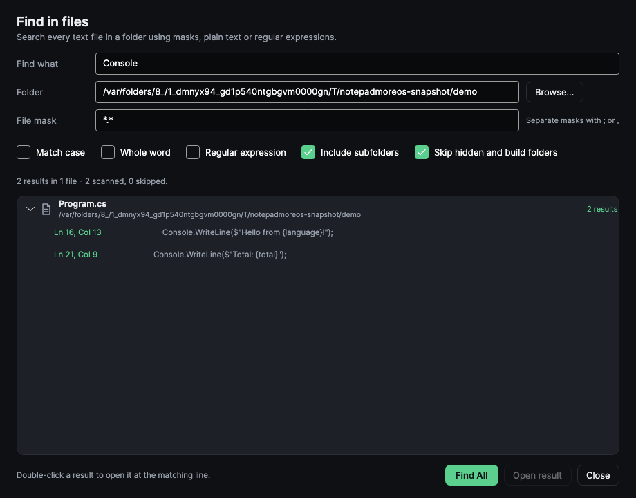
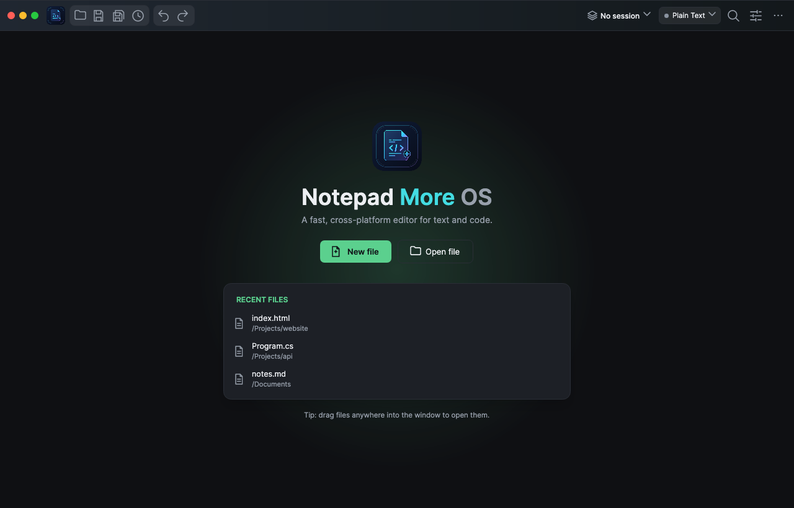
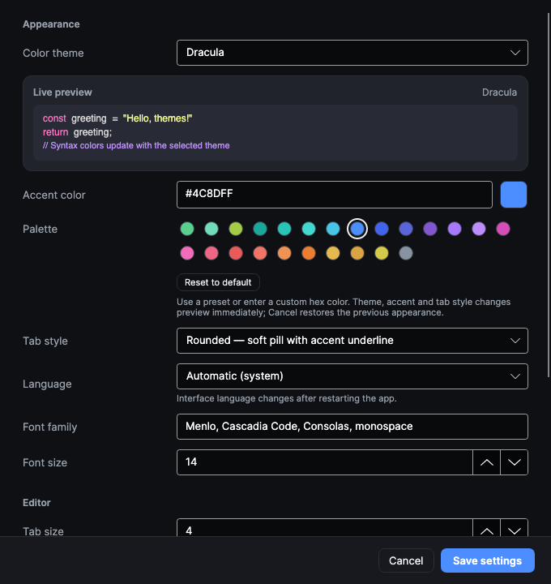
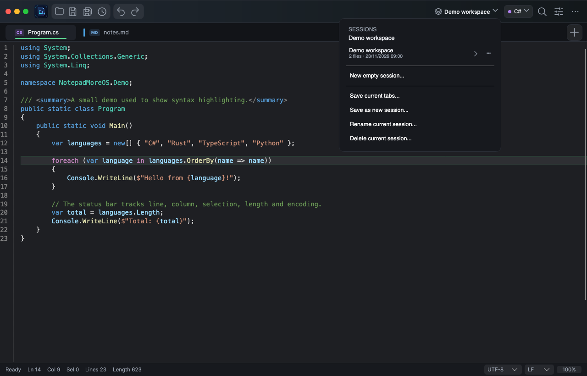
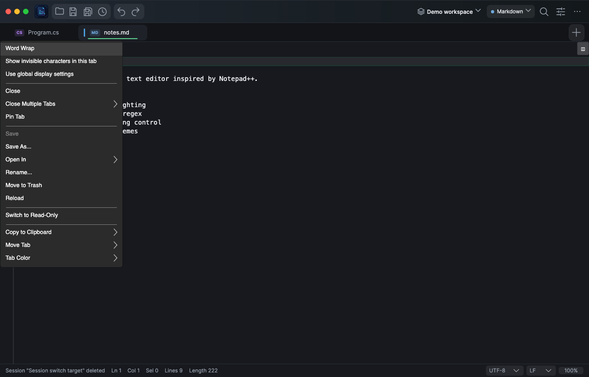

# Documentação do NotepadMoreOS

Este diretório reúne a documentação do editor em três camadas, para que o mesmo projeto seja compreensível por usuários, desenvolvedores e agentes de IA.

## Identidade visual

O símbolo combina documento, código e sinal de “mais”. O arquivo SVG correspondente é a fonte vetorial da marca.

| Documento | Para quem | O que responde |
|---|---|---|
| [Visão geral](VISAO-GERAL.md) | Todos | O que é, o que faz e como está organizado, sem jargão |
| [Guia do usuário](GUIA-USUARIO.md) | Qualquer pessoa | Como instalar, usar, configurar e resolver problemas |
| [Arquitetura](ARQUITETURA.md) | Desenvolvedores e arquitetos | Como o editor funciona por dentro e por que foi construído assim |
| [Desenvolvimento](DESENVOLVIMENTO.md) | Desenvolvedores e IAs | Convenções, receitas de mudança, testes e armadilhas |
| [Roadmap](ROADMAP.md) | Produto e comunidade | O que existe, o que vem depois e prioridades |
| [Release](RELEASE.md) | Mantenedores | Como gerar e publicar os instaladores (automático e manual) |
| [AGENTS.md](../AGENTS.md) | Agentes de IA | Contexto curto e operacional do repositório |
| [Changelog](../CHANGELOG.md) | Todos | O que mudou em cada versão |

## Screenshots

| Tema escuro | Tema claro |
|---|---|
|  |  |

| Busca no documento | Busca em arquivos |
|---|---|
|  |  |

| Boas-vindas | Preferências |
|---|---|
|  |  |

As preferências incluem prévia de tema e paleta com 24 cores de destaque, além de entrada hexadecimal personalizada.

| Sessões nomeadas | Menu de contexto das abas |
|---|---|
|  |  |

## Fontes de verdade

- **Código:** `src/NotepadMoreOS/`
- **Testes:** `tests/NotepadMoreOS.Tests/`
- **Screenshots e documentação visual:** `docs/`
- **Ferramenta de verificação visual:** `tools/NotepadMoreOS.UiSnapshot/`
- **Decisões e invariantes:** [ARQUITETURA.md](ARQUITETURA.md) e [AGENTS.md](../AGENTS.md)

> A interface do aplicativo está disponível em inglês e português do Brasil; os textos vêm de `src/NotepadMoreOS/Resources/` e a escolha fica em Preferências. A documentação está em português para atender ao público atual do projeto.

> As capturas são geradas em modo headless. No macOS real, File/Edit/Search/Encoding/View/Help ficam na barra de menus do sistema e a barra de workspace ocupa a área da title bar, com traffic lights próprios.
