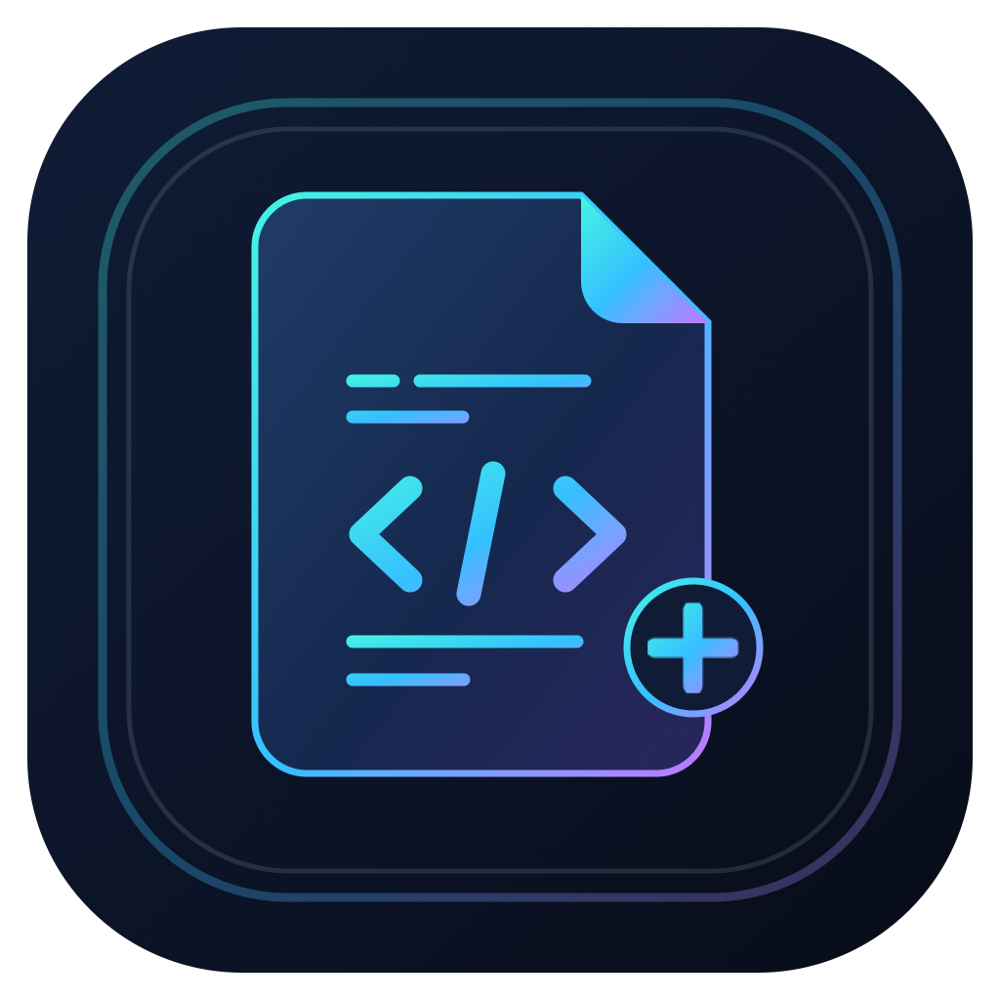

# Propostas de logo — NotepadMoreOS

Estas são três alternativas criadas a partir da referência. A proposta 3 foi escolhida e integrada ao aplicativo; as demais ficam documentadas como alternativas exploradas.

## 1. Vidro claro e neon

Mais próxima da referência enviada: moldura translúcida em camadas, folha azul-escura, código luminoso e sinal de “mais” em destaque.

## 2. Documento em destaque

Uma versão de alto contraste para ícone de aplicativo, com o documento claro sobre uma base azul-marinho e detalhes ciano/violeta.

## 3. Neon escuro

Alternativa mais sóbria e tecnológica, selecionada para o aplicativo: folha escura contornada por luz colorida e sinal de “mais” integrado ao canto inferior.

Os arquivos vetoriais das três alternativas estão em `logo-proposta-1.svg`, `logo-proposta-2.svg` e `logo-proposta-3.svg`. A proposta escolhida está integrada em `../src/NotepadMoreOS/Assets/appicon.svg`, com versões raster derivadas para o aplicativo.
